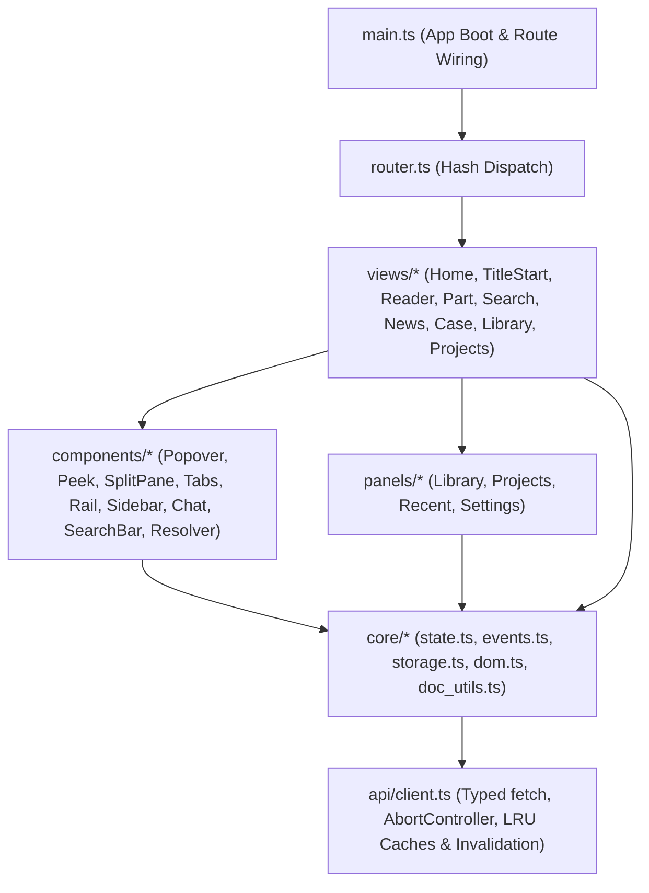

# Master Plan 13: Frontend Architecture, Type Safety & Engineering Hardening

**Status:** Completed (`2026-11-18`)  
**Series:** `10_platform_and_architecture` · Follows [`12_repo_structure_stabilization/`](../12_repo_structure_stabilization/MASTER_PLAN.md) & [`docs/notes/2026-11-16_pre-feature-orders.md`](../../notes/2026-11-16_pre-feature-orders.md) (Order 3)  
**Created:** 2026-11-18  
**Author / Collaborators:** Senior Frontend Engineering Review · Plan Scribe  
**Context / Motivation:** Following the Stage 5 Vite/ES-module split (`Plan 12`) and rapid feature delivery across `Plans 24, 25 (Phase 1), 31, 41`, the frontend (`reader/frontend/`, 44 JS/TS files, 17,675 lines) has accumulated severe structural debt: a 32-module circular dependency web, 2,297 hidden `--checkJs` TypeScript errors, duplicated reader/split-pane subsystems, runtime bottlenecks, accessibility gaps, and brittle Python source-slicing tests. This plan establishes clean module boundaries, enforces real type safety and JS unit testing, and hardens security, performance, and accessibility before completing `Plan 25` Phases 2–5 and `Plan 42` UI surfaces.

---

## 1. Problem Statement & Scope

- **Core Problem:** The automated `acorn` split left **379 directed import edges**, **25 mutual 2-cycles**, and a single **32-module Strongly Connected Component (SCC)** across `nav.js`, `router.js`, `panels/`, `components/`, and `views/`. Only **2 of 44** source files are `.ts` (`state.ts`, `citations.ts`), and `tsconfig.json` masks **2,297 type errors** behind `"checkJs": false`. Meanwhile, feature additions duplicated logic between the main reader and `#split-pane`, kept 24 raw `fetch()` calls outside any shared API layer, and left modals, streaming chat, and Part TOC hydration without proper abort, concurrency, or focus-trap controls.
- **In Scope:**
  - **Phase 1 — Dependency Decoupling & Shared Core (`src/api/`, `src/core/`, `dom.js`):** Extract a typed API/cache client, break the 25 mutual 2-cycles with a lightweight event/navigation bridge, and centralize storage/URL/clipboard/excerpt helpers.
  - **Phase 2 — Reader/Split Unification & God-Module Decomposition:** Consolidate duplicated main-pane and `#split-pane` subsystems (`para-tools`, broken-figure fallback, citation-graph/IBR hydration, transfer progress patching), decompose `views/news.js` (1,070 lines), `views/core.js` (970 lines), and `views/library.js` (860 lines), and replace 31+ ad-hoc `dom.view` listeners with a central view dispatcher.
  - **Phase 3 — Incremental TypeScript Strictness (`--checkJs` → `.ts`) & CI Gate:** Resolve all 2,297 `--checkJs` errors, eliminate `unknown` escape hatches and module-level mutable state (`newsState`, `lib`, `refUi`), migrate core modules to `.ts`, and enforce `npx tsc --noEmit` in `.github/workflows/ci.yml`.
  - **Phase 4 — Performance, Security & Accessibility Hardening:** Fix O(N²) streaming Markdown re-renders and missing `AbortController` in `chat.js`/`search_bar.js`/`cfr_resolver.js`, throttle Part TOC thumbnail hydration and replace the 2.5s `rAF` reflow loop in `reader_part.js`, enforce `safeHttpUrl` + uniform escaping across templates, and ship modal focus traps + missing ARIA roles/`type="button"` attributes.
  - **Phase 5 — JS Unit Tests, Brittle Slice Retirement & Playwright Expansion:** Add a native JS/TS unit test runner (`node --test` or `vitest`) for pure frontend logic, retire brittle Python source-slicing assertions in `test_sidebar_rail.py`, `test_news_frontend.py`, and `test_settings_env.py`, expand Playwright coverage for uncovered flows, and parameterize News UI for multi-agency expansion.
- **Out of Scope (Non-Goals):**
  - **Adopting a heavy UI framework (React/Vue/Svelte):** Keep FRAMEWORK's zero-framework vanilla TS + Vite architecture and committed `reader/static/dist/` + `build-stamp.json` contract (`AGENTS.md` Rule 1).
  - **Changing backend API payloads or golden snapshots:** Preserve `/api/*` response contracts (`tests/snapshots/`), router mounting order, and `route_inventory.json`.
  - **Re-opening locked UI decisions (`AGENTS.md` Rule 9)** or duplicating `Plan 25` Phases 2–5 feature specs (which will build cleanly *on top of* Phases 1–4 of this plan, or execute sequentially per Phase).
  - **Backend DOL expansion (`Plan 42`)** or **Platform Roadmap (`Plan 51`)** work.

---

## 2. Key Decisions & Rationales (Brainstorming Outcome)

| Decision Point | Option Chosen | Alternatives Considered | Rationale / Trade-offs |
| :--- | :--- | :--- | :--- |
| **Breaking Import Cycles** | Lightweight typed event/command bridge (`src/core/events.ts`) + unidirectional layers (`api` → `core` → `components`/`panels` → `views` → `router`) | Rewrite into a DI container or merge files back into monolith | Preserves zero-runtime-overhead ES modules and Vite output while eliminating all 25 mutual 2-cycles and `main.js` import-order fragility. |
| **TypeScript Migration Strategy** | Flip `"checkJs": true` module-by-module via JSDoc/`@ts-check` then rename `.js` → `.ts` | Big-bang rename of all 42 `.js` files at once | Allows small, reviewable PRs that keep `npm run build` and `test_build_stamp.py` green at every commit while burning down all 2,297 errors. |
| **JS Unit Testing** | Built-in Node 20+ test runner (`node --test`) or lightweight `vitest` over pure modules | Keep Python regex/source-slicing tests only | Node v26 is already pinned in `.nvmrc`/environment; testing `parseCfrHref`, `dockModel`, `findParagraphElement`, etc. directly is fast, deterministic, and eliminates fragile string-slicing tests. |
| **Reader vs. Split Pane Sharing** | Shared controller helpers (`attachDocInteractions(root, ctx)` in `views/doc_utils.ts`) parameterized by pane root | Separate parallel implementations in `reader.js` and `split_pane.js` | Guarantees parity for `Cite`, `Clip`, IBR peeks, broken-figure fallbacks, and future `Plan 25` Obligation Lens without double maintenance. |
| **Chat Streaming Rendering** | `requestAnimationFrame`-coalesced Markdown rendering + `AbortController` per turn | Per-SSE-chunk full `marked.parse` + `DOMPurify.sanitize` | Prevents O(N²) CPU/DOM thrashing on long regulatory answers and cleanly aborts streams on chat reset/close. |
| **Part TOC Thumbnail Hydration** | `IntersectionObserver` + bounded fetch queue (`maxConcurrency = 4`) | Eagerly fetching every static/visible slide on mount | Prevents burst request storms on large CFR parts (e.g., 29 CFR 1910) while keeping lazy previews snappy. |

---

## 3. Architecture & Component Changes



- **New Modules to Introduce:**
  - `reader/frontend/src/api/client.ts`: Centralized `requestJSON` / `requestText` with `AbortSignal`, HTTP error normalization, `state.graphCache` / `state.refsCache` / `titleTreeCache` LRU bounds, and `invalidateTitleCaches(title?)`.
  - `reader/frontend/src/core/events.ts`: Typed pub/sub bus (`jobs:updated`, `jobs:finished`, `titles:changed`, `projects:changed`, `nav:refresh`, `settings:changed`) breaking `nav.js` ↔ `panels/*` ↔ `views/*` cycles.
  - `reader/frontend/src/core/view_dispatch.ts`: Single delegated `dom.view` event registry (click/input/change/keydown/mouseover) replacing 31+ module-top-level listeners.
  - `reader/frontend/src/core/a11y.ts`: Shared `trapFocus(dialogEl, onClose)` + `#layout.inert` modal manager, live announcer helper, and `button` semantics helpers.
- **Files to Split / Consolidate:**
  - `reader/frontend/src/dom.js` → `dom.ts`: Absorb `safeHttpUrl()`, `copyToClipboard()`, `lsGetJSON()`, `lsSetJSON()`, and `extractDocExcerpt()` (removing duplicates from `news.js`, `peek.js`, `reader_part.js`, `library.js`, `reader.js`).
  - `reader/frontend/src/views/doc_utils.js` → `doc_utils.ts`: Absorb shared `bindParaTools()`, `bindBrokenImageFallback()`, `hydrateSectionGraph()`, and `updateRefsBadge()` used by both `views/reader.js` and `components/split_pane.js`.
  - `reader/frontend/src/views/news.js` (1,070 lines) → split into `views/news.ts` (feed & facets) + `views/news_case.ts` (Inspection Case File `#/news/inspection/{nr}`) + shared `news_format.ts`; parameterize agency/title instead of hardcoding Title 29 / OSHA.
  - `reader/frontend/src/views/core.js` (970 lines) → split into `views/title_start.ts` + `views/ref_almanac.ts` + `data/home_content.ts`.
  - `reader/frontend/src/views/library.js` (860 lines) → move `pollJobs`/`setJobs` into `components/transfer_dock.ts` (or `api/jobs.ts`) and share `renderTransferRows()` with `panels/library_panel.ts`.
  - `reader/frontend/src/components/ui.js` → `ui.ts`: Make escaping rules explicit (`metricCardHtml` / `emptyStateHtml` safe-by-default or explicitly named `*Html` slots), remove inline `style="..."` attributes into `02b_primitives.css`.
  - `reader/frontend/src/state.ts`: Replace `unknown` fields (`treeFilterState`, `navStorage`, `navNewsStatus`, `navEnvStatus`, `envModalSnapshot`) with concrete interfaces; absorb `newsState`, `lib`, and `refUi`.
- **Tests & CI:**
  - `reader/frontend/tests/*.test.ts` (or `.mjs`): Pure unit test suite.
  - `.github/workflows/ci.yml`: Add Node setup + `npx tsc --noEmit` + JS unit tests + `test_build_stamp.py` verification.
  - `reader/tests/test_browser_parity.py`, `test_sidebar_rail.py`, `test_news_frontend.py`, `test_settings_env.py`: Replace JS slice assertions with Playwright behavioral checks; fix `mask.getdata()` deprecation warnings.

---

## 4. Phased Implementation Roadmap

### Phase 1: Dependency Decoupling, Shared API & Core Utilities
- [x] **Task 1.1:** Create `src/api/client.ts` consolidating all 24 `fetch()` calls (`getJSON` moved out of `views/library.ts`), enforcing `res.ok`, `AbortSignal` propagation, LRU eviction on `graphCache`/`refsCache`/`splitTreeCache`, and cache invalidation when titles are downloaded, updated, or deleted.
- [x] **Task 1.2:** Move `safeHttpUrl`, `lsGetJSON`, `lsSetJSON`, `copyText`, and `extractDocExcerpt` into `dom.ts` (eliminating cross-view imports from `views/news.ts` into `views/home.ts`/`views/core.ts` and duplicate `DOMParser` / `JSON.parse` code).
- [x] **Task 1.3:** Introduce `src/core/events.ts` and refactor `nav.ts`, `router.ts`, `panels/*`, `views/projects.ts`, `views/library.ts`, and `components/transfer_dock.ts` to communicate via events/callbacks instead of mutual imports.
- **Exit Criteria / Checkpoint:** Static import-graph check reports **0 mutual 2-cycles** and **0 SCCs > 1 module** across `reader/frontend/src/`; `npm run build` and existing `pytest` + Playwright suites pass.

### Phase 2: Reader/Split Unification & God-Module Decomposition
- [x] **Task 2.1:** Extract shared document pane helpers in `views/doc_utils.ts` (`createParaToolsController`, `bindBrokenImageFallback`, `hydrateSectionGraph`, `updateRefsBadge`, `renderViewError`) and wire both `views/reader.ts` and `components/split_pane.ts` to them.
- [x] **Task 2.2:** Decompose `views/news.ts` (extract `views/news_case.ts` + `core/news_format.ts`), `views/core.ts` (extract `views/ref_almanac.ts` + `data/home_content.ts`), and `views/library.ts` (extract `api/jobs.ts` + `core/library_meta.ts`).
- [x] **Task 2.3:** Replace module-level `dom.view.addEventListener(...)` calls with a centralized delegated dispatcher (`core/view_dispatch.ts` `onView`).
- [x] **Task 2.4:** Replace inline `style="..."` strings in JS HTML builders with CSS tokens/classes, and audit `ui.ts` (`metricCardHtml`, `emptyStateHtml`) for explicit HTML-escaping contracts.
- **Exit Criteria / Checkpoint:** Zero duplicated `.para-tools` / broken-figure / graph-hydration blocks; all `pytest` + Playwright tests remain green.

### Phase 3: TypeScript Strictness (`checkJs` → `.ts`) & CI Enforcement
- [x] **Task 3.1:** Eliminate all `unknown` escape hatches in `state.ts` (`TreeFilterState`, `StorageSnapshot`, `NewsStatusSnapshot`, `EnvStatusSnapshot`) and type all API/store DTOs.
- [x] **Task 3.2:** Enable `checkJs: true` + `strict: true` in `tsconfig.json`, resolve all **2,297** diagnostics, and convert all 51 submodules under `src/` to `.ts` (keeping `main.js` checked via `checkJs: true` for `index.html` compatibility).
- [x] **Task 3.3:** Verify `tests/frontend_sources.py` extensionless `.ts`/`.js` resolution and add `npx tsc --noEmit` + `npm test` to `.github/workflows/ci.yml`.
- **Exit Criteria / Checkpoint:** `tsconfig.json` runs with `"strict": true` and `"checkJs": true` with **0 errors** in `npx tsc --noEmit`.

### Phase 4: Performance, Security & Accessibility Hardening
- [x] **Task 4.1 (Chat & Search):** Add `AbortController` cancellation to `chat.ts` and `search_bar.ts` (`res.ok` + abort on new input), and batch `chat.ts` streaming Markdown parses via `requestAnimationFrame`.
- [x] **Task 4.2 (Part TOC & Full Part):** Gate `part_toc.ts` thumbnail excerpt hydration behind `IntersectionObserver` (scoped to scroll container with `600px` prefetch margin) + bounded queue (`MAX_CONCURRENT_HYDRATE = 4`); prevent `ResizeObserver` stacking via `WeakMap`; replace `loadPartFull`'s 2.5s `rAF` reflow polling loop with `ResizeObserver` + image `load` listeners + `document.fonts.ready`.
- [x] **Task 4.3 (Security):** Apply `safeHttpUrl()` to external/DOM URLs (`ecfr_url`, `org_url`, `fullSrc`) and configure `DOMPurify` hooks (`afterSanitizeAttributes`) in `dom.ts`.
- [x] **Task 4.4 (Accessibility):** Add focus trapping + `#layout.inert` for `#env-modal` and `#figure-modal`; add `role="tab"` to `.toc-cpip` buttons in `part_toc.ts`; add combobox ARIA to `#search`; add `aria-live="polite"` announcements for two-click destructive arming (`projects.ts`, `library.ts`) and filter match counts (`search.ts`, `reader_part.ts`, `library.ts`); add `type="button"` to non-submit buttons in `index.html` and views.
- [x] **Task 4.5 (Multi-Agency News Prep):** Parameterize `views/news.ts` title/agency defaults via `NEWS_SCOPES` / `articleNewsTitle()` (`Title 29 / OSHA` default) ahead of `Plan 42` multi-agency expansion.
- **Exit Criteria / Checkpoint:** Zero unaborted race conditions in search/chat; bounded Part TOC fetch queue; modal focus trap & ARIA semantics verified in Playwright.

### Phase 5: JS Unit Suite, Slice Test Retirement & Playwright Coverage
- [x] **Task 5.1:** Add pure JS/TS unit test runner (`npm test` → `node tests/run.mjs` executing `tests/unit.test.ts` with `rolldown` + `node --test`) and wire `npm test` into `.github/workflows/ci.yml`.
- [x] **Task 5.2:** Retire brittle JS source-slicing assertions in `tests/test_sidebar_rail.py`, `tests/test_news_frontend.py`, and `tests/test_settings_env.py` (retaining `NEWS_CITE_RE` parity, backend API tests, and static HTML/CSS checks), using `mask.get_flattened_data()` in `test_browser_parity.py`.
- [x] **Task 5.3:** Expand `test_browser_parity.py` Playwright coverage for Help + Settings drawer/page + `.env` modal, News filters/setup notice/`#news-pop`, and Library sort/filter/two-click remove arming.
- **Exit Criteria / Checkpoint:** `npm test`, `npx tsc --noEmit`, `npm run build`, non-browser `pytest`, and `REQUIRE_BROWSER=1 pytest` all pass cleanly.

---

## 5. Risk Assessment & Mitigations

- **Risk:** Breaking import cycles and changing `dom.view` delegation accidentally changes initialization side effects or breaks `tests/frontend_sources.py` source-slice tests mid-migration.
  - *Mitigation:* Retire/migrate brittle Python slice tests early (or maintain temporary compatibility exports in `Plan 13` Phase 1–2 before Phase 5 cleanup) and keep `test_build_stamp.py` + `REQUIRE_BROWSER=1` Playwright running after every phase.
- **Risk:** Enabling `checkJs: true` surfaces 2,297 errors that stall feature work (`Plan 25` Phases 2–5).
  - *Mitigation:* Sequence **Phase 1 + Phase 2** before `Plan 25` Phases 2–5 so new features (`Aa` menu, Obligation Lens, Audit Brief export) land on clean `.ts` modules rather than deepening untyped god modules.
- **Risk:** Focus traps (`inert`) or ARIA changes shift visual focus rings in Playwright screenshot baselines.
  - *Mitigation:* Only apply `inert` while modals (`#env-modal`, `#figure-modal`) are open; verify all existing Pillow screenshot baselines remain pixel-identical.

---

## 6. Verification & Definition of Done (DoD)

- [x] **Import & Architecture Gate:** Custom import-graph script confirms `mutual2Cycles === 0` and zero multi-file SCCs under `reader/frontend/src/`.
- [x] **Typecheck, Unit Tests & Vite Build:**
  ```bash
  cd reader/frontend && npx tsc --noEmit && npm test && npm run build
  ```
- [x] **Full Non-Browser Test Suite (incl. `test_build_stamp.py` & `test_api_snapshots.py`):**
  ```bash
  cd reader && ../.venv/bin/python -m pytest tests -q --ignore=tests/test_browser_parity.py --ignore=tests/test_milestone2_browser.py --ignore=tests/test_milestone3_browser.py
  ```
- [x] **Strict Playwright Browser Gate (with zero Pillow warnings):**
  ```bash
  cd reader && REQUIRE_BROWSER=1 ../.venv/bin/python -m pytest tests/test_browser_parity.py tests/test_milestone2_browser.py tests/test_milestone3_browser.py -q
  ```
- [x] **Docs Synced:** Update [`CLAUDE.md`](../../../CLAUDE.md), [`docs/plans/README.md`](../../README.md), [`docs/plans/MAPPED_PLAN_OVERVIEW.md`](../../MAPPED_PLAN_OVERVIEW.md), and close Order 3 in [`docs/notes/2026-11-16_pre-feature-orders.md`](../../notes/2026-11-16_pre-feature-orders.md).
