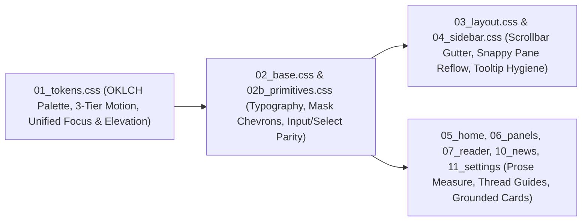

# Master Plan 14: UI Visual Craft, Optical Typography & Motion Calibration

**Status:** Completed (`2026-11-18`)  
**Series:** `10_platform_and_architecture` · Follows [`13_frontend_architecture_and_hardening/`](../13_frontend_architecture_and_hardening/MASTER_PLAN.md) · Complements [`25_white_glove_ui_ux_refinement/`](../../20_app_shell_and_workspace/25_white_glove_ui_ux_refinement/MASTER_PLAN.md)  
**Created:** 2026-11-18  
**Author / Collaborators:** Senior UI Craft Review · Plan Scribe  
**Context / Motivation:** Following the architectural refactor (`Plan 13`), a detailed audit of `reader/frontend/src/styles/` and `index.html` identified design-system nuances that separate competent dark-mode templates from studio-grade editorial software: gamma-muddy `srgb` color mixing, unequal perceived brightness across the 9 reference hues, negative body tracking and overly wide 100ch prose lines on dark surfaces, sluggish `340ms–800ms` UI micro-transitions, gradient/solid hover mismatches, fragmented input heights/focus halos, and subtle layout shifts from missing `scrollbar-gutter` and off-the-shelf lift hover effects on multi-action cards.

---

## 1. Problem Statement & Scope

- **Core Problem:** Visual polish currently leaves quality on the table across four craft layers:
  1. **Color & Surface Physics:** `01_tokens.css` mixes tier tints in gamma-encoded `srgb` (creating olive/muddy yellow and coral washes), uses unequal-luminance Tailwind hex stops for `--ref-*`, flattens `--card-bg` vertical sheen into solid `--card-hover` on hover, and dips readable metadata (`--fg-3: 0.45`, `--fg-4: 0.26`) close to WCAG contrast floors.
  2. **Optical Typography & Prose Rhythm:** `02_base.css` applies Inter-specific `"cv01", "ss03"` features and global `optimizeLegibility` over primary `"Geist"`, `07_reader.css` sets negative `-.011em` tracking on `16px` dark-mode body text across `724px` (~100ch) columns, indented `.lvl-2..lvl-6` guide borders break into disconnected vertical ticks at `.75em` gaps, and long-form `<mark>` / `↗` indicators clip or underline clumsily.
  3. **Spatial Alignment & Control Parity:** Multi-action cards (`news-card`, `toc-card`, `help-card`, `lib-story`) lift `translateY(-1px)` as if single buttons, `.lib-actions` omits `pointer-events: none` at rest while `.story-actions` paints a flat mask over a gradient card, inputs drift across `28px`/`30px`/`32px` with conflicting focus rings, `<select>` chevrons lock to static `#88888f`, `#main` lacks `scrollbar-gutter: stable`, and wide tables lack horizontal scroll hints.
  4. **Motion Choreography:** `340ms–460ms` button/popover micro-transitions feel floaty against `100ms–120ms` hardcoded rules in `03_layout.css` and `04_sidebar.css`, while `680ms–800ms` `grid-template-columns` transitions force continuous frame-by-frame text reflow inside `#main` and `#split-pane`.
- **In Scope:**
  - **Phase 1 — Perceptual Color Tokens (`oklch` / `oklab`), Contrast Floor & Surface Lighting:** Recalibrate `--ref-*`, neutral ramp, and card sheen/elevation tokens in `01_tokens.css` and primitives.
  - **Phase 2 — Optical Typography, Prose Measure & Legal Hierarchy Guides:** Tune font features, dark-mode weights, `65ch` reader flow, continuous `.lvl-*` container-relative guides, `text-wrap`, and `<mark>` / `↗` crispness.
  - **Phase 3 — Control Standardization, Card Affordances & Layout Stability:** Ground multi-action cards, fix `.lib-row`/`.story-actions` masking and hit targets, unify input sizes/focus halos, switch `--chevron` to `mask-image: currentColor`, add `scrollbar-gutter: stable` + `#main-tabs` corner matching, and add table horizontal-scroll indicators.
  - **Phase 4 — Crisp 3-Tier Motion Choreography & Tooltip Hygiene:** Compress micro-interaction timing to `90ms / 160ms / 240ms`, tighten popover offsets, shorten/soften pane reflows, and prevent keyboard return-focus tooltip leaks on `#activity-rail`.
- **Out of Scope (Non-Goals):**
  - **Re-opening locked UI decisions (`AGENTS.md` Rule 9):** Obsidian dark-mode-only palette, no collapsible sections, no inline TOC boxes, no per-paragraph ticks, `statPill` strictly for sync status, pinned `#view-head` steppers, and the three ways to read remain unchanged.
  - **Feature additions owned by `Plan 25` Phases 2–5:** Audit Brief export, Obligation Lens, `.doc-actions` `Aa` toolbar split, `#search >` surfacing, and mobile unit jumper stay in [`25_white_glove_ui_ux_refinement/`](../../20_app_shell_and_workspace/25_white_glove_ui_ux_refinement/MASTER_PLAN.md).
  - **JavaScript business logic or backend API changes:** Pure CSS/HTML craft refinements (plus any trivial class hooks in existing TSX/TS helpers where needed).

---

## 2. Key Decisions & Rationales (Brainstorming Outcome)

| Decision Point | Option Chosen | Alternatives Considered | Rationale / Trade-offs |
| :--- | :--- | :--- | :--- |
| **Semantic Color Calibration** | `oklch()` `--ref-*` stops + `color-mix(in oklab, ...)` surface tints | Keep hex stops + `color-mix(in srgb, ...)` | Equalizes perceived luminance across CFR, USC, FR, IBR, State, and County links on `#0B0B0D`/`#111114` and avoids muddy sRGB dark midtones. Modern Chromium (Playwright) & Safari support `oklch`/`oklab` natively. |
| **Card Lift Affordance (`translateY(-1px)`)** | Lift strictly on full-card single-target buttons (`.welcome-card`, `.hm-starter`); ground multi-action cards | Keep `-1px` lift across every `.surface-card`, `.news-card`, `.toc-card`, `.lib-story` | Multi-action containers shift targets slightly under the cursor and miscommunicate empty padding clickability. Illumination (`border-color` + sheen) gives clearer feedback. |
| **Prose Column Width (`820px` vs `66ch`)** | Constrain `.reg-body` text blocks to `max-width: 66ch` inside the `820px` view container | Keep `724px` (~100ch) line lengths across `.view` | Legal reading comfort peaks around `62–68ch` while wide tables (`.table-wrap`) and headers (`.doc-step`, `.doc-actions`) still benefit from the full `820px` span. |
| **Select & Summary Chevrons** | CSS `mask-image: var(--chevron)` with `background-color: currentColor` | Hardcoded `#88888f` SVG data URI in `background` | Chevrons inherit state/hover/disabled colors automatically without DOM changes or extra inline `<svg>` nodes. |
| **Micro-Interaction Timing Scale** | Unified 3-tier tokens (`--t-snap: 90ms`, `--t-ui: 160ms`, `--t-pane: 240ms`) | Keep `340ms–800ms` transitions | Eliminates sluggishness on buttons/popovers and minimizes multi-frame text re-wrapping during chat/split pane opens, while `html[data-motion="less"]` remains calm fades. |

---

## 3. Architecture & Component Changes



- **Affected Files:**
  - `reader/frontend/index.html`: Optional `<link rel="preload" as="font" href="/static/fonts/GeistVariable.woff2" crossorigin>` to curb FOUT on cold launch (`no-cache` static serving).
  - `reader/frontend/src/styles/01_tokens.css`: Calibrate `--ref-*` in `oklch()`, raise `--fg-3` contrast floor, refine opaque/balanced `--line*` tokens, add `--field-focus` halo token, unify card top-sheen elevation tokens, and compress `--t-snap`/`--t-ui`/`--t-pane` timing scale (`--motion-y: 6px`).
  - `reader/frontend/src/styles/02_base.css` & `02b_primitives.css`: Scope `"cv01", "ss03"` strictly to Inter / tabular contexts or remove blind Geist override; scope `optimizeLegibility` to headings; standardize `.ui-input` / `.ui-select` heights (`30px`) & focus rings; convert `--chevron` to `mask-image: currentColor`; tone `.skel-shimmer` gradient contrast.
  - `reader/frontend/src/styles/03_layout.css` & `04_sidebar.css`: Add `scrollbar-gutter: stable` on `.main`; unify `#search` focus halo; prevent `.ar-btn:focus-visible::after` shortcut tooltip leak on programmatic focus return; tighten layout transitions (`240ms`).
  - `reader/frontend/src/styles/05_home_overview_lib.css`, `06_panels_proj.css`, `10_news.css`, `11_settings_help.css`: Preserve gradient sheen on card hover; remove `translateY(-1px)` from multi-action cards; add `pointer-events: none` to unhovered `.lib-actions` and eliminate `.story-actions` solid-vs-gradient mask seam; add `text-wrap: balance/pretty` on card titles/deks.
  - `reader/frontend/src/styles/07_reader.css` & `09_responsive.css`: Cap `.reg-body > .reg-p, .reg-callout` around `66ch` while letting `.table-wrap` span wider; tune `.reg-body` tracking (`0em`) & optical weights; join consecutive `.lvl-2..lvl-6` border guides cleanly and drive indent step via `@container main`/`@container split`; add horizontal overflow scroll shadows on `.table-wrap`/`.ins-table-wrap`; add `box-decoration-break: clone` on `mark`; smooth `#main-tabs` + `.view-head` top-corner framing.

---

## 4. Phased Implementation Roadmap

### Phase 1: Perceptual Color Tokens, Contrast Floors & Surface Lighting
- [x] **Task 1.1:** Convert the 9 `--ref-*` palette variables in `01_tokens.css` to luminance-balanced `oklch()` values and migrate surface tint mixes across `02b_primitives.css`, `05_home_overview_lib.css`, and `07_reader.css` from `in srgb` to `in oklab`.
- [x] **Task 1.2:** Calibrate neutral `--fg-3` contrast against `--panel`/`--card` for 11px–12px metadata, reserve `--fg-4` for non-text separators, and refactor `--card-bg`/`--card-top`/`--card-hover` so card hover preserves the top specular highlight gradient instead of flattening.
- **Exit Criteria / Checkpoint:** Inspect Home, Reader (with multi-tier xrefs), News, and Part TOC visually; yellow/cyan/violet/green tier chips read at uniform visual weight and borders show zero flat-vs-gradient flicker.

### Phase 2: Optical Typography, Legal Prose Measure & Thread Guides
- [x] **Task 2.1:** Audit `font-feature-settings` and `text-rendering` in `02_base.css` (limit Inter-only alternates and `optimizeLegibility` to headings); enable `font-optical-sizing: auto` and calibrated dark-mode variable font weights (`--w-regular`/`--w-medium`/`--w-semibold`) in `01_tokens.css`; deduplicate the double `@font-face` registration for `InterVariable.woff2` or add Geist font preload in `index.html`.
- [x] **Task 2.2:** Adjust `.reg-body` tracking (`0` instead of `-.011em`) and enforce a ~`66ch` optimal reading measure while letting `.table-wrap` expand cleanly; apply `text-wrap: balance` / `text-wrap: pretty` to headings and descriptions.
- [x] **Task 2.3:** Make `.reg-p.lvl-2..lvl-6` left hierarchy borders continuous across adjacent same-level siblings, convert level indentation to container-relative `@container main`/`split` `--indent-step` tokens (replacing viewport `@media (max-width: 900px)` rules in `09_responsive.css`), add `box-decoration-break: clone` on `mark`, and refine `↗` link suffix styling.
- **Exit Criteria / Checkpoint:** Long CFR sections (e.g., `29 CFR 1910.1200`) and narrow `#split-pane` views show balanced ~65ch line length, uninterrupted indent thread lines, and crisp inline highlights.

### Phase 3: Control Parity, Grounded Cards & Scroll Chrome
- [x] **Task 3.1:** Standardize input/select heights (`30px` utility / `32px` topbar), focus rings (`--field-focus`), and placeholder opacity across `02b_primitives.css`, `03_layout.css`, `04_sidebar.css`, `05_home_overview_lib.css`, `10_news.css`, and `11_settings_help.css`.
- [x] **Task 3.2:** Replace the static `#88888f` background data-URI `--chevron` on `<select>`s and `<details>` summaries with `mask-image` + `currentColor`.
- [x] **Task 3.3:** Remove `translateY(-1px)` lift from multi-action containers (`.news-card`, `.toc-card`, `.help-card`, `.lib-story`), add `pointer-events: none` to hidden `.lib-actions`, fix the `.story-actions` / `.lib-actions` hover reveal seam, add `scrollbar-gutter: stable` on `.main`, refine `#main-tabs` top framing inside `#main`, and add CSS horizontal scroll-shadow cues on `.table-wrap` / `.ins-table-wrap`.
- **Exit Criteria / Checkpoint:** Short vs. long routes no longer nudge centered headings sideways; multi-action cards stay planted under the pointer; table overflow is visually self-evident.

### Phase 4: Motion Choreography & Tooltip Hygiene
- [x] **Task 4.1:** Compress timing tokens in `01_tokens.css` (`--t-snap: 90ms`, `--t-ui: 160ms`, `--t-pane: 240ms`, `--motion-y: 6px`), remove hardcoded one-off transitions in `03_layout.css` and `04_sidebar.css`, and tune `.cite-pop` / `.pin-pop` / `.title-pop` pop-in curves (`02_base.css`).
- [x] **Task 4.2:** Tighten `.layout` and `.main-stage.is-split` `grid-template-columns` transition durations to minimize protracted line-rewrap jitter during open/close slides, quiet `.skel-shimmer` contrast, and guard `.ar-btn` CSS tooltip display so programmatic focus returns on `Esc` / drawer close don't pop open shortcut hints unprompted.
- [x] **Task 4.3:** Rebuild `reader/static/dist/` (`npm run build`), run all Playwright parity & baseline checks (refreshing `tests/baselines/darwin/` intentionally after inspecting visual diffs), and update `CLAUDE.md` + plan status.
- **Exit Criteria / Checkpoint:** `npx tsc --noEmit && npm test && npm run build`, non-browser `pytest`, and `REQUIRE_BROWSER=1 pytest` all pass cleanly.

---

## 5. Risk Assessment & Mitigations

- **Risk:** OKLCH color updates, card hover/padding alignment, `scrollbar-gutter: stable`, and `66ch` measure changes will intentionally alter pixels across existing Pillow baselines (`tests/baselines/darwin/*.png` & `win32`).
  - *Mitigation:* Execute Phases 1–4 as a cohesive visual pass or update baselines explicitly (`UPDATE_BASELINES=1 REQUIRE_BROWSER=1`), inspect every regenerated `.png` before committing, and trigger CI `record_baselines` if targeting Windows baselines too.
- **Risk:** Styling tweaks accidentally break CSS contract tests in `test_news_frontend.py`, `test_sidebar_rail.py`, or `test_settings_env.py` (which assert token-only colors — zero raw `#hex` in view blocks — and exact `.main` grid rules).
  - *Mitigation:* Keep **all** color values parameterized as `:root` custom properties inside `01_tokens.css` (`--ref-*`, `--line*`, etc.), preserve exact `.layout` grid-track declaration formatting where asserted, and run `pytest` after every phase.
- **Risk:** `backdrop-filter`, `color-mix(in oklab, ...)`, or `scrollbar-gutter` behaves subtly across headless Chromium versions or mobile viewports (`390x844`).
  - *Mitigation:* Verify both desktop (`1280x800`) and mobile (`390x844`) Playwright baselines plus full/split panes (`#main-stage.is-split`).

---

## 6. Verification & Definition of Done (DoD)

- [x] **Frontend Typecheck, Unit Tests & Build:**
  ```bash
  cd reader/frontend && npx tsc --noEmit && npm test && npm run build
  ```
- [x] **Non-Browser Suite (CSS Token Contracts, Build Stamp, API Snapshots):**
  ```bash
  cd reader && ../.venv/bin/python -m pytest tests -q --ignore=tests/test_browser_parity.py --ignore=tests/test_milestone2_browser.py --ignore=tests/test_milestone3_browser.py
  ```
- [x] **Strict Playwright Gate (with reviewed visual baseline refresh):**
  ```bash
  cd reader && REQUIRE_BROWSER=1 ../.venv/bin/python -m pytest tests/test_browser_parity.py tests/test_milestone2_browser.py tests/test_milestone3_browser.py -q
  ```
- [x] **Docs Updated:** Mark [`docs/plans/README.md`](../../README.md), [`docs/plans/MAPPED_PLAN_OVERVIEW.md`](../../MAPPED_PLAN_OVERVIEW.md), and [`CLAUDE.md`](../../../CLAUDE.md) current on completion.
