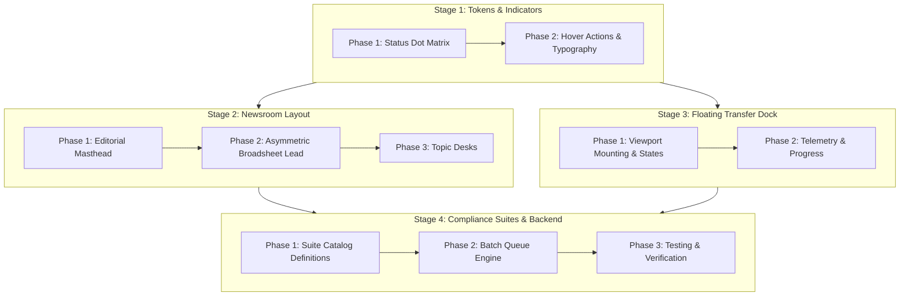

# Master Plan: Enterprise Newsroom Layout & Floating Download Hub Refactor

## Executive Overview

This master plan governs the end-to-end transformation of the **FRAMEWORK** regulatory reader's library (`#/library`) and download interface into an **Enterprise Newsroom & Regulatory Intelligence Hub**. 

The architecture fuses:
1. **Newsroom Editorial Hierarchy**: Asymmetric broadsheet lead, live 7-day regulatory wire ticker, topic desks, kickers, headlines, standfirst deks, and curated compliance suites.
2. **Linear Precision Design System**: Restrained monochromatic palettes, hairline borders, 6px illuminated status dots, smooth gradient action disclosures, and high-density tabular typography.
3. **Cross-View Floating Transfer Dock**: A persistent, globally mounted download HUD that stays active while reading or browsing, complete with real-time transfer telemetry and pipeline phase tracking.
4. **Compliance Suite Bundles**: Pre-packaged regulatory suites (e.g., EHS Core, Commerce & Trade) with batch queuing and single-click "Update All Outdated" operations.

---

## Directory Hierarchy & Plan Architecture

The rollout is divided into **4 Stages**, each composed of **Phases**, and each phase subdivided into **Parts**:

```
docs/plans/20_app_shell_and_workspace/22_editorial_download_refactor/
├── MASTER_PLAN.md
├── stage-1_tokens_and_indicators/
│   ├── README.md
│   ├── phase-1_status_dot_matrix/
│   │   ├── part-1_status_dot_tokens.md
│   │   └── part-2_status_pill_components.md
│   └── phase-2_hover_actions_and_masks/
│       ├── part-1_contextual_action_bars.md
│       └── part-2_tabular_telemetry_typography.md
├── stage-2_newsroom_layout/
│   ├── README.md
│   ├── phase-1_editorial_masthead/
│   │   ├── part-1_repository_metrics_banner.md
│   │   └── part-2_edition_freshness_kicker.md
│   ├── phase-2_asymmetric_broadsheet_lead/
│   │   ├── part-1_featured_suite_hero.md
│   │   └── part-2_regulatory_wire_ticker.md
│   └── phase-3_topic_desks/
│       ├── part-1_desk_headers_and_density.md
│       └── part-2_editorial_story_briefs.md
├── stage-3_floating_transfer_dock/
│   ├── README.md
│   ├── phase-1_dock_architecture/
│   │   ├── part-1_persistent_viewport_mounting.md
│   │   └── part-2_dock_minimized_expanded_states.md
│   └── phase-2_telemetry_and_pipeline_progress/
│       ├── part-1_progress_bar_and_glow.md
│       ├── part-2_throughput_and_eta.md
│       └── part-3_pipeline_phase_descriptors.md
└── stage-4_compliance_suites_and_backend/
    ├── README.md
    ├── phase-1_compliance_suite_definitions/
    │   ├── part-1_suite_catalog_metadata.md
    │   └── part-2_size_and_leaf_enrichment.md
    ├── phase-2_batch_queue_engine/
    │   ├── part-1_batch_download_endpoint.md
    │   └── part-2_update_all_outdated_job.md
    └── phase-3_testing_and_verification/
        ├── part-1_backend_suite_tests.md
        └── part-2_ui_regression_checklist.md
```

---

## Stage Breakdown & Dependency Flow



---

## Quality & Architectural Constraints

1. **Zero Layout Regressions**: Existing reading panel (`#/section/{id}`), units mode, rail, search, and topbar navigation must remain pristine.
2. **Offline-First & Thread-Safe**: Title releases (`store.release_title`) and atomic SQLite database replacements on Windows/macOS must continue uninterrupted.
3. **No External Dependencies**: Vanilla ES6 JS in `reader/static/app.js` and pure CSS in `reader/static/styles.css`; no npm packages, framework additions, or bundle steps.
4. **Test Integrity**: All existing 70 tests in `reader/tests` must pass at every part boundary.
