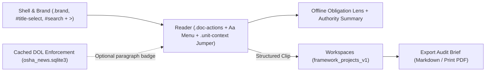

# Master Plan 25: White-Glove UI/UX Refinement, Ergonomics & Deliverable Workflows

> **Status:** Paused — Phase 1 Completed; Phases 2–5 Deferred (2026-11-19)  
> **Direction Note:** Per the 2026-11-19 federal-only pivot (Linear `FRAMEWORK`), **moving the UI away from its CFR-centric focus** across federal frameworks (CFR, Federal Register, U.S.C.) takes precedence over Plan 25's deliverable-workflow agenda (Phases 2–5). State coverage and HSE/DOL-specific workflows are out of scope going forward; reusable reader ergonomics from Phases 2–5 will be folded in after the federal UI refocus.  
> **Series:** `20_app_shell_and_workspace` · Follows [`24_dark_newsroom_multi_jurisdiction_ui/`](../24_dark_newsroom_multi_jurisdiction_ui/MASTER_PLAN.md)  
> **Created:** 2026-11-18  
> **Context / Motivation:** Following the multi-jurisdiction dark newsroom refactor (Plan 24), a white-glove creative director & UI/UX audit against live macOS visual baselines (`reader/tests/baselines/darwin/`) uncovered CSS border-radius defects, a `0 of 0 installed` suite bug, mobile/split-pane reader navigation gaps, primary CTA inflation, and high-leverage opportunities to elevate FRAMEWORK's daily utility and marketability without breaking local-first or snapshot contracts.

---

## 1. Problem Statement & Scope

- **Core Problem:** While FRAMEWORK's typography, indentation hairlines, and hover-peek architecture are strong, rough visual edges (curved `border-left` artifacts, a vestigial `"E"` mobile monogram/favicon, empty catalog/wire panels), multi-row toolbar clutter on mobile/compact widths, and passive JSON-only workspace outputs hold the experience back from commercial-grade polish.
- **In Scope:**
  - **Phase 1 — Visual Craft & Live Bug Fixes:** Fix curved left-edge tier bars, replace the `"E"` monogram/favicon with a true geometric FRAMEWORK mark + signature accent token, fix `0 of 0 installed` in `suiteState` / `library_panel.js`, eliminate empty Wire/metric dead states, and tighten truncated blurbs/placeholders.
  - **Phase 2 — Hierarchy, Toolbar Consolidation & Mobile Reader Ergonomics:** Enforce single-primary-CTA discipline on Home/News, streamline `.doc-actions` into one clean desktop row + `Aa` display/utility popover, make `.unit-context` an interactive unit jumper when `.rail` is hidden, add subtle scrolled-position context inside `#view-head`, and tune inline reference color weight + News category stripe contrast.
  - **Phase 3 — Structured Workspace Clips & Exportable Compliance Audit Briefs:** Upgrade `clipToWorkspace` from raw concatenated strings to structured clause objects with jump-to-paragraph links, add browser-storage backup nudges, and ship 1-click **Export Audit Brief** (Markdown + Print-ready HTML/PDF) from any Workspace (`#/projects/{id}`).
  - **Phase 4 — Offline Reader Intelligence ("Obligation Lens" & Authority/Enforcement Surface):** Add a deterministic zero-LLM **Obligation & Deadline Lens** (`shall` / `must` / `prohibited` / timing triggers) in the reader, surface a visual **Authority Dependency Summary** from `app/citations/graph.py`, and bridge decoded DOL IMIS paragraph hits (`osha_news.sqlite3`) onto matching paragraphs when available.
  - **Phase 5 — Command Discovery, First-Run Polish & Baseline Verification:** Surface `> Commands` + recent jumps inside `#search`, add a zero-wait sample/feature preview strip on `welcome.js` during initial download, rebuild `reader/static/dist/`, and refresh macOS visual baselines.
- **Out of Scope (Non-Goals):**
  - **Re-opening locked UI decisions (`AGENTS.md` Rule 9):** No collapsible sections, inline TOC boxes, or per-paragraph ticks in the reader; no breadcrumbs in the main panel; no prev/next cards at the bottom or in the sidebar; no "Getting around" box on Title Start; no badges/chips in the Contents sidebar; rail hover never scrolls; `statPill` remains strictly for sync state; "three ways to read" remain intact.
  - **Light/Paper Theme Toggle:** Plan 24 deliberately locked FRAMEWORK to the obsidian dark palette (`:root` dark-only, keeping `@media print` white paper). Re-introducing a light theme is deferred unless explicitly approved as a separate decision.
  - **Backend DOL API v4 Expansion (`Plan 42`):** Queued separately in [`42_dol_api_expansion/`](../../40_regulatory_intelligence_and_dol/42_dol_api_expansion/MASTER_PLAN.md); Plan 25 only reads already-synced local enforcement data if present.
  - **Multi-agency News scraping or new server APIs:** All Phase 3–4 capabilities run client-side or over existing local endpoints without altering `/api/titles` or golden API snapshots.

---

## 2. Key Decisions & Rationales (Brainstorming Outcome)

| Decision Point | Option Chosen | Alternatives Considered | Rationale / Trade-offs |
| :--- | :--- | :--- | :--- |
| **Left Accent Bars on Rounded Cards** | `overflow: hidden` + straight `::before` 3px bar (`inset: 0 auto 0 0`) | Keep `border-left: 3px solid` on `border-radius: 12px` | `border-left` bends into pinched hooks on 12px corners (observed on `overview` and `news` baselines); `::before` stays razor-sharp while preserving rounded borders. |
| **Brand Mark & Accent Token** | Geometric `[F]` / rule-line SVG favicon + mobile mark; dedicated `--accent` hue | Keep vestigial `.brand-e` (`"E"`) + `--accent == --fg` | `"E"` is a leftover from "eCFR" and looks broken on mobile; a crisp geometric mark + restrained accent anchors brand recall. |
| **Pre-Wired Empty Authority Tabs in Library** | De-emphasize empty tiers (show installed tiers + compact *"Planned Jurisdictions"* disclosure) | Keep 4 empty tabs (`U.S. Code`, `States`, `Counties`, `Standards`) in primary tab bar | Preserves Plan 24 `CorpusSummary` contracts while removing "under construction" scaffolding from primary navigation. |
| **Reader Action Bar (`.doc-actions`)** | Primary row (mode toggle, Pin, News, `#btn-cited-by`, `#btn-refs-ledger`) + `Aa` / overflow utility menu (`eCFR`, `Copy link`, `A−/A+` with `px` readout) | Keep all 8+ buttons inline with `flex-wrap` | Eliminates 2-row desktop / 3-row mobile wrapping while keeping `#btn-cited-by` and `#btn-refs-ledger` one click away (preserving browser parity & M3 selectors). |
| **Mobile Multi-Unit Navigation** | Interactive `.unit-context` trigger opening a compact unit-jumper popover when `.rail` is hidden | Re-show `.rail` on mobile or leave static text | Honors `AGENTS.md` (no inline TOC box in reader body) and preserves reading width while fixing the 14-tap mobile dead end. |
| **Dark-Only Surface Lock** | Retain Plan 24 Obsidian Dark `:root` + white-paper `@media print` | Re-introduce `[data-theme="light"]` toggle | Avoids violating Plan 24's dark-only contract; `@media print` still powers clean Audit Brief PDF output. |
| **Obligation & Deadline Lens** | Client-side deterministic regex/span highlighter over `.reg-body` (toggleable in `Aa` / display menu) | Server-side HTML mutation or LLM extraction | Zero latency, 100% offline, preserves `section_html` cache and `test_api_snapshots.py` payloads. |
| **Workspace Export Upgrade** | Backward-compatible `clips[]` array alongside `note` + Markdown & Print Audit Brief generator | Breaking schema migration or JSON-only export | Existing `framework_projects_v1` JSON imports stay 100% compatible while turning Workspaces into client/auditor deliverables. |

---

## 3. Architecture & Component Changes



- **Affected Files & Modules:**
  - `reader/frontend/index.html`: Replace `"E"` SVG favicon and `.brand-e` markup with geometric FRAMEWORK mark; keep `#nav-toggle`, `#title-select`, `#search`, `#chat-toggle` IDs intact.
  - `reader/frontend/src/styles/01_tokens.css`: Calibrate `--accent` signature token; add `--lens-duty`, `--lens-deadline` subtle highlight tokens.
  - `reader/frontend/src/styles/02b_primitives.css`, `05_home_overview_lib.css`, `10_news.css`, `07_reader.css`, `09_responsive.css`: Fix `.has-tier-bar` / `.news-card` / `.resolver-card` `::before` accent bars; streamline `.doc-actions` + `Aa` popover; style `.unit-context` interactive trigger & jumper popover; refine inline `.xref*` resting contrast; separate `public_inspection` vs `enforcement` stripe hues; update mobile brand sizing.
  - `reader/frontend/src/panels/library_panel.js` & `reader/frontend/src/views/library.js`: Fix `suiteState` / `renderLibraryPanel` `0 of 0 installed` calculation against `s.titles.length`; suppress empty `.reg-wire` void and `0 · Show` action on `AMENDED THIS WEEK`; tuck unpopulated authority tiers into a quiet catalog capability footer.
  - `reader/app/title_blurbs.json` & `reader/frontend/src/views/home.js`: Trim overly long summaries/kicker agency lists so Home 3-column cards don't truncate mid-word; remove redundant primary CTA buttons (`.btn-accent` reserved for `Resume reading`).
  - `reader/frontend/src/views/reader.js`, `components/view_head.js`, `components/rail.js`: Split `.doc-actions` into primary controls + `Aa` utility menu (showing current `px` font size and **Obligation Lens** toggle); make `.unit-context` open a unit-outline picker when `.rail` is hidden; add quiet scrolled-heading indicator in `#view-head`; optionally cross-link cached local DOL citation counts on matching paragraphs.
  - `reader/frontend/src/views/projects.js` & `reader/frontend/src/state.ts`: Add backward-compatible structured `clips` support in `clipToWorkspace` + Workspace **Export Audit Brief** (`.md` download & `window.print()` brief view) + subtle *"Stored locally · Last exported"* indicator.
  - `reader/frontend/src/components/search_bar.js`, `components/palette.js`, `views/welcome.js`: Surface `> Commands` + recent sections in empty-focus `#search` dropdown; shorten `#news-q` placeholder in `views/news.js`; add lightweight interactive capability strip / sample jump on `welcome.js`.

---

## 4. Phased Implementation Roadmap

### Phase 1: Visual Craft & Live Bug Fixes
- [x] **Task 1.1:** Refactor `.has-tier-bar`, `.news-card`, `.toc-group-head`, and `.resolver-card` to use `overflow: hidden` + straight `::before` 3px bars instead of `border-left: 3px solid` on `border-radius: 12px` boxes.
- [x] **Task 1.2:** Replace the `"E"` SVG favicon and mobile `.brand-e` fallback with a geometric FRAMEWORK monogram (`[F]` / rule-line mark) and assign `--accent` a calibrated signature hue in `01_tokens.css`.
- [x] **Task 1.3:** Fix `suiteState()` and `renderLibraryPanel()` so suites whose titles are absent from a partial/filtered catalog display `0 of {s.titles.length} installed` (never `0 of 0 installed`).
- [x] **Task 1.4:** Fix Library empty-state edges: render a compact offline/empty message or hide `.reg-wire` body space when empty, omit `Show` on `AMENDED THIS WEEK` when count is `0`, and move empty pre-wired authority tiers (`U.S. Code`, `States`, `Counties`, `Standards`) into a clean *"Planned Jurisdiction Connectors"* footer unless `extraCorpora` populates them.
- [x] **Task 1.5:** Shorten `title_blurbs.json` summaries (~95–110 chars, keeping `<= 140` test invariant), limit Home card kickers to 2 agencies so `OSHA · WHD · EB...` doesn't clip, and shorten `#news-q` placeholder in `views/news.js`.
- **Exit Criteria:** `overview`, `library`, `news`, and `section-units` (desktop + mobile) show zero `0 of 0`, zero clipped placeholders, straight 3px bars, and clean brand mark.

### Phase 2: Hierarchy, Reader Toolbar & Mobile Ergonomics
- [ ] **Task 2.1:** Enforce 1 primary `.btn-accent` CTA per screen on Home (`Resume reading`) and News (keep feed card links `.btn` secondary), removing duplicate `+ New workspace` header clutter when Workspaces empty card is visible.
- [ ] **Task 2.2:** Refactor `.doc-actions` in `views/reader.js` so desktop renders one clean row (reading-mode switch, `Pin`, `News`, `#btn-cited-by`, `#btn-refs-ledger`, and a compact `Aa / Tools` popover holding font `A−` / `16 px` / `A+`, `Copy link`, `eCFR ↗`, `Print`).
- [ ] **Task 2.3:** Make `.unit-context` (`Clause (a) · Unit 1 of 14`) an interactive button when `.rail` is hidden (`@container main (max-width: 780px)` / `@media (max-width: 900px)`), opening a compact unit-outline popover via `createPopover()` while preserving `test_milestone3_browser.py`'s `.unit-context` count = 0 assertion on short/full sections.
- [ ] **Task 2.4:** Add a quiet centered current-location label inside `#view-head` (`.doc-step`) that fades in only once `.doc-title` scrolls out of view.
- [ ] **Task 2.5:** Differentiate `public_inspection` from `enforcement` stripes in `10_news.css` and soften resting underline saturation for local/same-title inline links in `07_reader.css` so high-priority external/statute/IBR references pop cleanly.
- **Exit Criteria:** `.doc-actions` fits on a single row at 1280px desktop and ≤2 compact rows on 390px mobile; mobile users can jump directly to any clause/appendix unit in ≤2 taps.

### Phase 3: Structured Workspace Clips & Exportable Audit Briefs
- [ ] **Task 3.1:** Extend `normalizeWorkspace` / `clipToWorkspace` in `views/projects.js` to store structured `clips` (`{ id, para, cite, quote, clipped_at }`) alongside existing `note` strings (100% backward-compatible with `framework_projects_v1` JSON imports).
- [ ] **Task 3.2:** Render clipped provisions as crisp quote cards inside `#/projects/{id}` with one-click deep-link jump back to `?p=...` and copy-citation action.
- [ ] **Task 3.3:** Add **Export Audit Brief** to Workspace detail & overview (`Download .md` + `Print / Save PDF` formatted cover, authority tier stack, clips, notes, and Action Project status) plus a quiet *"Stored in browser · Last exported …"* indicator.
- **Exit Criteria:** Clipping a clause from main or split reader creates a jumpable quote card; exporting a Workspace produces a clean Markdown brief and print-styled PDF without developer JSON artifacts.

### Phase 4: Offline Reader Intelligence & Cross-Surface Bridges
- [ ] **Task 4.1:** Add an **Obligation & Deadline Lens** toggle inside the reader's `Aa / Tools` menu (persisted in `localStorage`) that deterministically highlights modal duty phrases (`shall`, `must`, `shall not`, `prohibited`, `required to`) and timing/recordkeeping cues (`within \d+ days`, `annually`, `written`) in `.reg-body` without mutating raw HTML caches.
- [ ] **Task 4.2:** Enhance `#btn-refs-ledger` / `#btn-cited-by` with a unified summary header showing the section's **Authority Stack** (`Statute → CFR → IBR Standards → Cited By N`) so `app/citations/graph.py` intelligence is immediately scannable.
- [ ] **Task 4.3:** When Title 29 is open and `/api/news/section/{id}` returns cached DOL enforcement hits with decoded paragraph paths, display subtle inline citation counts on matching paragraphs / inside `#news-pop` (strictly read-only over already-fetched local data; zero new network requests).
- **Exit Criteria:** Obligation Lens toggles cleanly across unit/full views and print mode; no changes to API snapshot schemas or backend network rules.

### Phase 5: Command Discovery, First-Run Polish & Verification
- [ ] **Task 5.1:** Update `#search` empty-focus dropdown (`components/search_bar.js`) to show recent visited sections and a subtle `Type > for commands or § to jump` footer hint; rename the `Title start` rail tooltip to `Title {N} Overview` to clarify `Home` vs `Title start`.
- [ ] **Task 5.2:** Add a quiet *"What's inside FRAMEWORK"* capability strip / instant preview walkthrough on `views/welcome.js` so first-run evaluators see Split Reading, Hover Peeks, and Workspaces while eCFR titles download.
- [ ] **Task 5.3:** Rebuild `reader/static/dist/` (`npx tsc --noEmit && npm run build`), add targeted Playwright assertions in `tests/test_browser_parity.py` & `tests/test_milestone3_browser.py`, refresh `tests/baselines/darwin/`, and update `CLAUDE.md` + `docs/plans/` status.

---

## 5. Risk Assessment & Mitigations

- **Risk:** Changing DOM structure in `.doc-actions`, `home.js`, or `library.js` breaks existing Playwright assertions or screenshot baselines.
  - *Mitigation:* Preserve critical selector IDs (`#btn-cited-by`, `#btn-refs-ledger`, `#btn-news-activity`, `.unit-context` absence on short/full sections), run full `REQUIRE_BROWSER=1` Playwright suites, and intentionally re-record `tests/baselines/darwin/` only after visual inspection.
- **Risk:** Adding inline `<span>` highlights for the Obligation Lens interferes with `window.getSelection()` (`selection_tool.js`), `resolveParagraphPath`, or `highlightTarget`.
  - *Mitigation:* Wrap text nodes purely with lightweight `<mark class="ob-cue">` elements inside `.reg-body` after `enhanceDomAnchors`, strip/skip them cleanly during `clipToWorkspace` text extraction, and keep `resolveParagraphPath` relying on `.pmark` structure untouched.
- **Risk:** Shortening `title_blurbs.json` strings or editing `views/library.js` trips `tests/test_library_front_page.py` or `tests/test_api_snapshots.py`.
  - *Mitigation:* Keep all `title_blurbs.json` summaries `<= 140` chars, preserve JSON keys, and keep all `/api/*` response shapes unchanged.

---

## 6. Verification & Definition of Done (DoD)

- [ ] **Typecheck & Vite Build:**
  ```bash
  cd reader/frontend && npx tsc --noEmit && npm run build
  ```
- [ ] **Full Non-Browser Test Suite (including `test_build_stamp.py`, `test_api_snapshots.py`, `test_library_front_page.py`):**
  ```bash
  cd reader && ../.venv/bin/python -m pytest tests -q --ignore=tests/test_browser_parity.py --ignore=tests/test_milestone2_browser.py --ignore=tests/test_milestone3_browser.py
  ```
- [ ] **Playwright Browser Suites & Baseline Verification:**
  ```bash
  cd reader && REQUIRE_BROWSER=1 ../.venv/bin/python -m pytest tests/test_browser_parity.py tests/test_milestone2_browser.py tests/test_milestone3_browser.py -q
  ```
- [ ] **Visual Sign-Off:** Re-recorded `tests/baselines/darwin/*.png` inspected across desktop (`1280×800`) and mobile (`390×844`), confirming zero curved bar hooks, zero `0 of 0`, single-row desktop `.doc-actions`, working mobile unit jumper, and clean Audit Brief print output.
