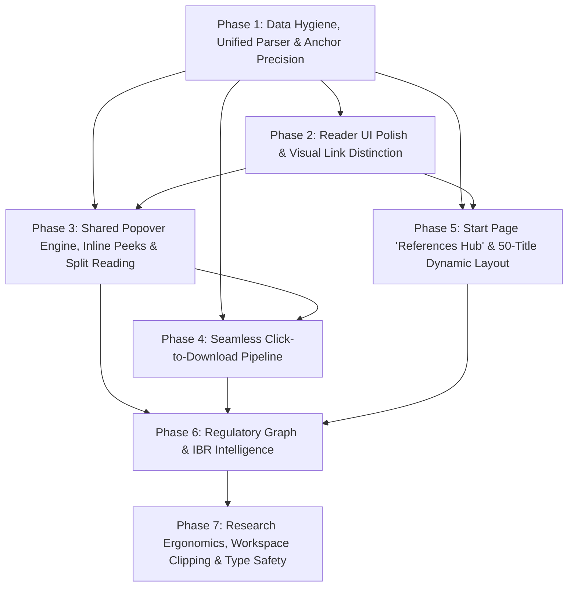

# CFR Reader Evolution: Master Development Plan

## 1. Vision & Architecture Overview

The goal of this initiative is to evolve the CFR Reader from a static document viewer into an interconnected, visually balanced, and authoritative regulatory research workstation—built directly on its existing **FastAPI + SQLite FTS5** backend and modular **Vite / Vanilla ES + TypeScript** frontend.

Based on our **Reference Corpus Taxonomy** ([`REFERENCE_TAXONOMY.md`](file:///Users/gibdevlite/Desktop/FRAMEWORK/docs/plans/30_cfr_reader_and_citations/31_reader_development/REFERENCE_TAXONOMY.md)), **Stack Research**, and **21-Screen Visual & Code Audit** (`UI_VISUAL_AUDIT.md`), the roadmap is organized into **seven logically ordered phases** plus a **Cross-Cutting Refactor Track** so data hygiene, parser unification, and shared UI primitives pave the way for richer reader intelligence:

---

## 2. Master Implementation Phases

### Phase 1: Data Hygiene, Unified Citation Parser & Anchor Precision
*Fixes live ingest defects, eliminates regex order bugs caught in rendering, and guarantees every citation resolves to a deterministic target.*

1. **Ingest & Display HTML Tag Hygiene**
   * **Verified Bug:** [`trim_tree`](file:///Users/gibdevlite/Desktop/FRAMEWORK/reader/app/ingest/tree.py#L17-L31) ingests eCFR HTML tags verbatim from `label_description` (verified **13 section rows** in SQLite and **32 nodes** in `tree-29.json`, such as `Appendix C to Subpart T of Part 1910`: `...§ 1910.401(a)(3)...` and `§ 18.401`: `Definition of <em>relevant evidence.</em>`).
   * Strip/unescape markup cleanly during tree construction and section indexing (plus a defensive read-time cleaner in [`store.py`](file:///Users/gibdevlite/Desktop/FRAMEWORK/reader/app/store.py) for pre-existing databases).
2. **Unified Citation Parser (`app/citations/parser.py`)**
   * Consolidate fragmented citation regexes across [`linkifier.py`](file:///Users/gibdevlite/Desktop/FRAMEWORK/reader/app/render/linkifier.py), [`news.py`](file:///Users/gibdevlite/Desktop/FRAMEWORK/reader/app/news.py), and [`citations.ts`](file:///Users/gibdevlite/Desktop/FRAMEWORK/reader/frontend/src/citations.ts) into a structured span extractor supporting both HTML linkification and metadata indexing.
   * **Plural Cross-Title Part Fix:** Fix live bug caught on `§ 1910.120(a)(1)(iv)` where `"40 CFR parts 264 and 265"` misses `_CROSS_TITLE` and falls through to `_WORD_PART`, wrongly linking `parts 264` to **Title 29 Part 264**.
   * **Clean URL Delimitation:** Strip trailing sentence punctuation (`.`, `,`, `;`, `)`, `",`) from external `<a href="...">` URLs.
   * **Unlinked Reference Coverage:** Handle bare section mentions in prose (`"comply with 1910.134"`), compound paragraph tuples (`paragraphs (a) through (d) of this section`, `(c)(1) and (d)(2)`), subparts (`subpart B of this part`), external appendices (`appendix A to § 1910.120`), and multi-title CFR cross-refs across all 32 cited titles.
3. **Deep Target Anchor Synthesis & Interactive Footnotes**
   * Assign deterministic DOM IDs in [`html.py`](file:///Users/gibdevlite/Desktop/FRAMEWORK/reader/app/render/html.py) and [`units.py`](file:///Users/gibdevlite/Desktop/FRAMEWORK/reader/app/render/units.py): tables (`#table-z-1`), figures (`#figure-l-1`), embedded appendices (`#appendix-a`), and bi-directional footnotes (`#ftref-1` &harr; `#fn-1` with jump-back links).
   * Fix missing front-matter footnote captures identified in `REFERENCE_TAXONOMY.md`.

---

### Phase 2: Reader UI Polish, Visual Hierarchy & Responsive Container Fixes
*Addresses every visual friction, layout misalignment, and mobile truncation observed in the screenshot walkthrough.*

1. **Sticky Header & Action Toolbar Refinement**
   * **`.doc-step` Alignment & Scrim Opacity:** Align `.doc-step` horizontal padding (`48px` vs `.view`'s `48px`, removing the current `6px` left offset) and raise upper `.view-head::before` opacity so scrolled buttons don't faintly bleed behind navigation labels.
   * **Eliminate `.doc-actions` Orphan Wrap:** Separate primary mode toggles (`See full section` / `Read in parts`, `See full part`), dossier/news actions (`Pin`, `Activity`), and compact utilities (`eCFR`, `Copy link`, `A−/A+`) or tighten spacing so `A− A+` stops wrapping onto a solitary second row on desktop and stays tidy on mobile (`390px`).
2. **Visual Link Distinction & Data Grid Ergonomics**
   * **Link Taxonomy Cueing:** Visually distinguish local internal links, downloadable uninstalled cross-title CFRs, statutory `U.S.C.`/`FR` citations, and third-party web links within the Linear/Vercel monochromatic palette (e.g., solid vs. dotted underlines and micro-badges).
   * **Sticky Table Headers:** Keep `<thead>` columns visible during vertical scrolling of massive regulatory tables like `Table Z-1` (`§ 1910.1000`), and turn table footnote numbers (`1`) into clickable jump/peek triggers.
   * **Dark-Mode Figure Comfort:** Add an optional subtle dim/invert view toggle or click-to-lightbox zoom on bright `#fff` Federal Register figure cards in dark mode.
3. **Unit Rail & Spatial Orientation Fixes**
   * **Short-Section Rail Suppression:** Suppress the rail on short `mode === 'page'` sections (`<= 3` units without substantial scroll) where solitary 2-bar dashes add noise.
   * **Proportional Rail Bars & Container Hiding:** Apply `u.chars` width scaling to `.rail-bar` (`8px`–`16px`) matching the comment in [`rail.js`](file:///Users/gibdevlite/Desktop/FRAMEWORK/reader/frontend/src/components/rail.js), and switch rail visibility + reader layout rules from window `@media` to `@container main` so Sidebar + Chat together never collide `.rail` with text margins.
   * **Units-Mode Spatial Indicator:** Show a compact inline unit indicator / quick switcher pill (e.g., `Clause (a) · 1/34` or `Appendix A · A.1`) when viewing a single unit inside long sections.
4. **Mobile Chrome & Topbar Polish (`390px`)**
   * Shorten `#search` placeholder at `< 600px` (`"Search…"`) so it never clips mid-word (`"Search regulatio..."`).
   * Adjust `.activity-rail` mobile `::before` active bar `bottom` offset so it renders unclipped inside the bottom bar.

---

### Phase 3: Shared Popover Engine, Inline Peeks & Split Reading
*Replaces duplicate popover math with one collision-aware primitive and removes navigation fatigue during dense research.*

1. **Shared Collision-Aware Popover Primitive (`components/popover.js`)**
   * Refactor duplicated viewport clamping, outside-click handlers, Escape closing, and focus restoration across [`pin_pop.js`](file:///Users/gibdevlite/Desktop/FRAMEWORK/reader/frontend/src/components/pin_pop.js), [`news_activity.js`](file:///Users/gibdevlite/Desktop/FRAMEWORK/reader/frontend/src/components/news_activity.js), [`title_switcher.js`](file:///Users/gibdevlite/Desktop/FRAMEWORK/reader/frontend/src/components/title_switcher.js), and [`selection_tool.js`](file:///Users/gibdevlite/Desktop/FRAMEWORK/reader/frontend/src/components/selection_tool.js) into one shared engine (adding subtle close controls and optional filter headers where long lists like `21 rules & citations` appear).
2. **Inline Hover / Tap "Peek" Popovers**
   * Instant non-navigating preview cards built on `createPopover`:
     * **Internal Paragraphs & Sections:** Exact text of `paragraph (c)(1)` or section heading + summary.
     * **Tables & Figures:** Snippets/thumbnails of cited tables (e.g., `Table Z-1`, `Table R-3`).
     * **Footnotes:** Full `.reg-footnote` content displayed inline on hover/tap.
3. **Side-by-Side Reference Split Pane**
   * `Alt/Option + Click` or a "Pin to Side" affordance opens cited regulations (`§ 1926.651` beside `§ 1926.652`, or `§ 1910.6` IBR alongside a standard) in a secondary reading pane inside `#main`.
4. **Smooth Anchor Scroll & Target Flash**
   * Extend [`highlightParagraph`](file:///Users/gibdevlite/Desktop/FRAMEWORK/reader/frontend/src/views/reader.js) to animate focus flashes for tables, figures, appendices, and multi-paragraph target ranges.

---

### Phase 4: Seamless "Click-to-Download" & Micro-Scope Ingestion
*Turns uninstalled cross-title CFR links (like `40 CFR 261.3` or `49 CFR 172.101`) from external jumps into instant in-app expansions.*

1. **Installed Corpus Detection & Resolver Routing**
   * Intercept clicks on uninstalled CFR links in [`router.js`](file:///Users/gibdevlite/Desktop/FRAMEWORK/reader/frontend/src/router.js) and render an in-reader micro-card via the Phase 3 popover or dedicated inline resolver view instead of throwing 404.
2. **In-Reader On-Demand Install Prompt**
   > **40 CFR Part 261 is not installed.**  
   > `[ Download Section § 261.3 ]` &nbsp; `[ Download Full Part 261 ]` &nbsp; `[ View on eCFR ↗ ]`
3. **Background Micro-Scope Streaming**
   * Queue narrow-scope fetches via `/api/library/download` leveraging [`normalize_scope`](file:///Users/gibdevlite/Desktop/FRAMEWORK/reader/app/build.py) and [`TransferDock`](file:///Users/gibdevlite/Desktop/FRAMEWORK/reader/frontend/src/components/transfer_dock.js).
   * Automatically transition into the freshly indexed section as soon as ingestion commits, preserving scrollback history.

---

### Phase 5: Title Start "References & Authorities" Hub & 50-Title Dynamic Layout
*Replaces the empty center on un-curated titles and replaces the static "Getting around" tips box with a live categorized reference directory.*

1. **Responsive 3-Column Start Page & Dynamic Fallback for All 50 Titles**
   * Widen Title Start (`.view:has(> .home-hero)` to `1080px–1140px`, 3-column grid) so curated cards sit in 2 crisp rows above the fold instead of 3 tall rows.
   * Replace hardcoded `{29, 40, 49}` `HOME_CONTENT` dependency in [`core.js`](file:///Users/gibdevlite/Desktop/FRAMEWORK/reader/frontend/src/views/core.js) with dynamic key chapters/parts and metadata from [`title_blurbs.json`](file:///Users/gibdevlite/Desktop/FRAMEWORK/reader/app/title_blurbs.json) + `tree.json` so every CFR title (including Title 3) renders a rich start page.
   * Surface a contextual *"Continue in Title N"* resume bar on the Title Start page matching the Home overview experience.
2. **Backend Reference Extraction Endpoint (`GET /api/{title}/references`)**
   * Query the Phase 1 unified citation extractor to aggregate all 227+ web URLs, 82+ domains, standards organizations, and external portals in the title.
3. **References & Authorities Directory (Replacing "Getting Around")**
   * Categorize links cleanly under **Standards Organizations (ANSI, NFPA, ASTM, ASME, CGA, ACGIH)**, **Federal Portals (SAM.gov, GPO, Regulations.gov, EPA)**, and **Agency Directives & Forms (OSHA, NIOSH, CDC)**.
   * Include **Provenance Backlinks ("Cited in")** pointing back to the exact mandating sections (`§ 95.13`, `§ 1910.106`), plus **Legacy/Defunct URL Badges** (`wdol.gov`, `epls.arnet.gov`) with modern redirects.

---

### Phase 6: Regulatory Knowledge Graph & IBR Intelligence
*Exposes bidirectional regulatory dependencies and links embedded consensus standards back to statutory incorporation tables.*

1. **Reverse Citation Index ("Cited By")**
   * Compute incoming Title/cross-title citations at ingest/cache layer to add a `"Cited by N sections"` header badge + drawer on foundational regulations (`§ 1910.134`, `§ 1910.1200`).
2. **Incorporation by Reference (IBR) Resolver**
   * Detect consensus standard designators (`ANSI Z87.1-2003`, `NFPA 101-2009`, `ASTM D93-79`) and resolve them directly to the title's statutory IBR catalog (`§ 1910.6`, `§ 1926.6`), displaying approved editions and vendor/depository details in a peek popover or split view.

---

### Phase 7: Research Ergonomics, Workspace Clipping & Type Safety
*Tightens daily research loops and graduates the frontend architecture cleanly without unnecessary bloat.*

1. **Clause-Level Permalinks & Clip-to-Workspace**
   * Paragraph/table hover affordance to copy legal citations (`29 C.F.R. § 1910.134(c)(1)(ii)`) or deep URLs, plus one-click **"Clip to Workspace / Dossier"** capturing snippet text and provenance notes.
2. **Reading Mode Persistence & Partial DOM Updates**
   * Persist `units` vs `full` section reading preferences per part.
   * Refactor filterable list views ([`search.js`](file:///Users/gibdevlite/Desktop/FRAMEWORK/reader/frontend/src/views/search.js), [`library.js`](file:///Users/gibdevlite/Desktop/FRAMEWORK/reader/frontend/src/views/library.js)) to patch result containers instead of blowing away full `#view` innerHTML and manually restoring cursor positions.

---

## 3. Cross-Cutting Refactor & Engineering Hygiene Track

| Area | Refactor Action | Target Modules |
| :--- | :--- | :--- |
| **Route Cancellation** | Attach an `AbortController` per `routeSeq` and pass `{ signal }` into `fetch()` calls so fast switching aborts in-flight requests instead of silently discarding finished payloads. | [`router.js`](file:///Users/gibdevlite/Desktop/FRAMEWORK/reader/frontend/src/router.js), [`reader.js`](file:///Users/gibdevlite/Desktop/FRAMEWORK/reader/frontend/src/views/reader.js), [`reader_part.js`](file:///Users/gibdevlite/Desktop/FRAMEWORK/reader/frontend/src/views/reader_part.js), [`search.js`](file:///Users/gibdevlite/Desktop/FRAMEWORK/reader/frontend/src/views/search.js) |
| **Container-Scoped CSS** | Convert reader-pane breakpoints (`.rail` visibility, `.doc-actions` compaction, split view) from `window` `@media` to `@container main` so simultaneous Sidebar + Chat drawers adapt gracefully. | [`03_layout.css`](file:///Users/gibdevlite/Desktop/FRAMEWORK/reader/frontend/src/styles/03_layout.css), [`07_reader.css`](file:///Users/gibdevlite/Desktop/FRAMEWORK/reader/frontend/src/styles/07_reader.css), [`09_responsive.css`](file:///Users/gibdevlite/Desktop/FRAMEWORK/reader/frontend/src/styles/09_responsive.css) |
| **Strict TypeScript Boundaries** | Replace the 47 `any` fields in `AppState` with strict DTO interfaces (`TitleMeta`, `SectionDoc`, `UnitItem`, `ReferenceEntry`) covering all new reference/peek contracts. | [`state.ts`](file:///Users/gibdevlite/Desktop/FRAMEWORK/reader/frontend/src/state.ts), [`citations.ts`](file:///Users/gibdevlite/Desktop/FRAMEWORK/reader/frontend/src/citations.ts) |
| **Shared View Shell** | Extract common error rendering, kicker generation, and document chrome wrappers duplicated between section, part-TOC, and full-part loaders. | [`reader.js`](file:///Users/gibdevlite/Desktop/FRAMEWORK/reader/frontend/src/views/reader.js), [`reader_part.js`](file:///Users/gibdevlite/Desktop/FRAMEWORK/reader/frontend/src/views/reader_part.js) |

---

## 4. Locked Architectural Decisions & Execution Milestones

Optimized for maximum architectural cleanliness, long-term extensibility across all 50 CFR titles, and zero redundant rewrites:

### Architectural Decisions
* **ADR-1 · Data-Driven Start Page (All 50 CFR Titles):** [`renderHome`](file:///Users/gibdevlite/Desktop/FRAMEWORK/reader/frontend/src/views/core.js) will widen to match the `1140px` 3-column container layout and stop relying exclusively on hardcoded `HOME_CONTENT` entries (`29, 40, 49`). Starter cards will be generated dynamically from `tree.json` chapters/top parts + [`title_blurbs.json`](file:///Users/gibdevlite/Desktop/FRAMEWORK/reader/app/title_blurbs.json) (keeping editorial blurbs as optional overrides), alongside the live **References & Authorities Hub** (`Phase 5`). Every installed CFR title gets a balanced, above-the-fold layout automatically.
* **ADR-2 · Non-Destructive Figure Framing + Lightbox:** Dark-mode figures (`.reg-figure`) will swap stark `#ffffff` floodlight borders for a soft neutral paper mat (`#f4f4f5` at `brightness(0.92)` in `[data-theme="dark"]`) rather than automatic CSS inversion (which distorts warning signage and halftones), paired with an in-app click-to-zoom lightbox featuring a manual high-contrast invert toggle (`Phase 2`).
* **ADR-3 · Foundation-First Milestone Sequencing:** Data hygiene (`trim_tree` HTML stripping), the unified `app/citations/parser.py` engine, `@container main` responsive CSS, and the shared `createPopover` primitive are executed **before** interactive Peeks, On-Demand Downloads, and the References Hub—guaranteeing every downstream feature shares a single parser and UI infrastructure without rework.

### Execution Milestones & Guardrails
* **Milestone 1 (Clean Foundations & Reader Polish — Phases 1 & 2):** Data hygiene, unified citation parser, deep anchors & bi-directional footnotes, `.doc-step`/`.doc-actions` alignment, sticky table headers, proportional container-scoped unit rail, semantic link styles, and mobile chrome fixes.
* **Milestone 2 (Interactive Flow & On-Demand Resolution — Phases 3 & 4):** Shared `createPopover`, hover peeks, `Alt+Click` split reading pane, and seamless `Click-to-Download` micro-cards wired to `TransferDock`.
* **Milestone 3 (Title Hub & Regulatory Graph — Phases 5, 6 & 7):** Dynamic 50-title Start Page + References Hub replacing "Getting around", reverse `"Cited By"` backlinks, IBR standards resolver, clause permalinks/clipping, and full `state.ts` TypeScript hardening.
* **CI & Verification Contracts:**
  * Run `cd reader/frontend && npm run build && npx tsc --noEmit` after every frontend edit to keep `static/dist/build-stamp.json` aligned with [`tests/test_build_stamp.py`](file:///Users/gibdevlite/Desktop/FRAMEWORK/reader/tests/test_build_stamp.py).
  * Validate backend/frontend suites with `cd reader && ../.venv/bin/python -m pytest tests -q` (and explicitly inspect & regenerate affected visual baselines in `tests/baselines/{darwin,win32}/` via `UPDATE_BASELINES=1` when `Phase 2` intentionally upgrades `section-units` geometry).

---

## 5. Linked Evidence & Supporting Documents

* **Corpus Reference Taxonomy:** [`docs/plans/30_cfr_reader_and_citations/31_reader_development/REFERENCE_TAXONOMY.md`](file:///Users/gibdevlite/Desktop/FRAMEWORK/docs/plans/30_cfr_reader_and_citations/31_reader_development/REFERENCE_TAXONOMY.md)
* **Visual & Stack Audit (with 21 Live Captures):** Artifact [`UI_VISUAL_AUDIT.md`](file:///Users/gibdevlite/.gemini/antigravity/brain/7845c790-4a4f-4984-8c79-ca5f75efc66c/UI_VISUAL_AUDIT.md).
* **Status:** **All Milestones (`1–3` / `Phases 1–7`) & Cross-Cutting Refactor Track Complete** (`darwin` visual baselines, Milestone 1–3 Playwright behavioral suites, and TypeScript/Vite build verified green; `win32` baselines will need CI `record_baselines` refresh if merging on Windows).
