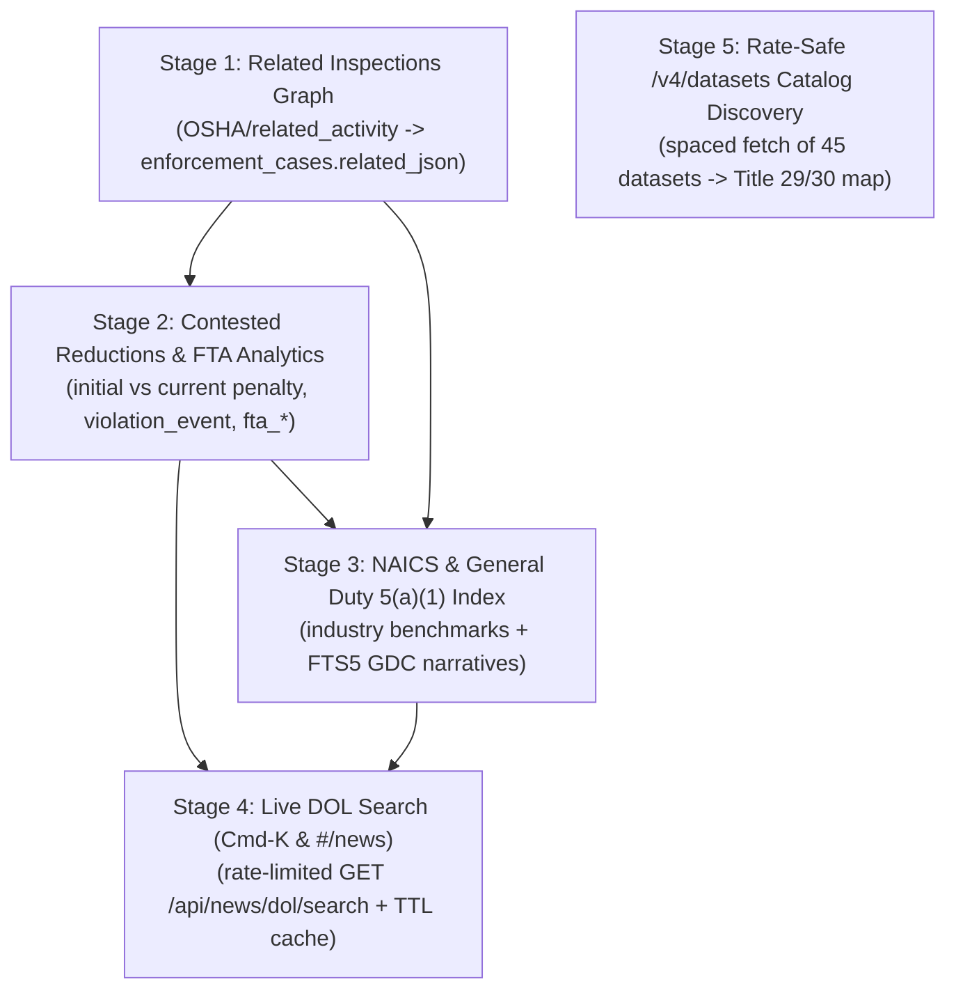

# Master Plan 42: DOL Open Data API v4 Expansion & Enforcement Intelligence

> **Status:** Planned (**Next Plan — Do Not Execute Yet**)  
> **Series:** `40_regulatory_intelligence_and_dol` · Follows [`41_osha_news_interface/`](../41_osha_news_interface/MASTER_PLAN.md)  
> **Recorded:** 2026-11-17

---

## 1. Executive Overview

Plan 41 delivered FRAMEWORK's sanctioned Regulatory Newsroom (`#/news`), schedule-gated Federal Register + DOL v4 sync, local `osha_news.sqlite3` storage, and the in-app **Inspection Case File** (`#/news/inspection/{activity_nr}`) that replaced dead-end `osha.gov` CAPTCHA links.

Live probing against **`https://apiprod.dol.gov/v4`** revealed substantial structured enforcement and regulatory intelligence already exposed by the DOL API v4 gateway that Plan 41 only touched at the surface. **Plan 42** turns those verified endpoints and fields into five incremental, offline-testable capabilities—strictly engineered around DOL's rate limits and upstream quirks:

1. **Related Inspections Cross-Links (`OSHA/related_activity`)**: Follow-up, complaint, referral, and multi-employer inspections linked directly inside `#/news/inspection/{activity_nr}`.
2. **Contested Reductions & Failure-to-Abate Analytics (`OSHA/violation`, `OSHA/violation_event`)**: Initial vs. current penalty reductions, revision timelines, and FTA flags surfaced both inside Case Files and aggregated per Title 29 Part/Section.
3. **NAICS Industry & General Duty `5(a)(1)` Index (`OSHA/inspection`, `OSHA/violation_gen_duty_std`)**: Industry benchmarks by `naics_code` and full-text discovery over General Duty Clause hazards that carry no CFR section number (`5A0001`).
4. **Live Employer / NAICS / Hazard Lookup (`⌘K` & `#/news`)**: User-triggered, cached on-demand search beyond the 150 synced cases by establishment name, NAICS, state, hazardous substance (`hazsub1`–`hazsub5`), or CFR standard.
5. **Rate-Safe DOL Catalog Discovery (`/v4/datasets`)**: Throttled enumeration of all DOL datasets (`meta.total_count: 45` observed) to map non-OSHA DOL sources (e.g., Wage & Hour, OWCP, MSPA, MSHA) to additional Title 29 and Title 30 parts for future plans.

---

## 2. Foundation Already Shipped (Plan 41 Baseline)

Do not re-implement these primitives; extend them cleanly:

- **Backend client & parsers (`reader/app/news.py`)**:
  - `_dol_get()` passing `?X-API-KEY=` via query params, returning `[]` on `HTTP 204`, and stripping secrets from `SourceUnavailable` errors.
  - `DOL_INSP_BATCH = 50` chunking `in` queries to stay under the API Gateway ~2 KB URL limit.
  - `parse_dol_standard()` decoding IMIS strings (e.g. `"19101030 G02   IIA"` -> `section="1910.1030"`, `para="(g)(2)(ii)(A)"`) into reader paragraph deep-links.
  - `build_enforcement_article()` and `fetch_inspection_case()` querying `OSHA/inspection`, `OSHA/violation`, `OSHA/violation_event`, `OSHA/violation_gen_duty_std`, and `OSHA/accident*`.
- **SQLite Store (`reader/app/news_store.py`)**:
  - `osha_news.sqlite3` (`PRAGMA user_version = 1`, WAL writes + `mode=ro` `query_only=ON` read path via `connect(readonly=True)`).
  - Tables: `articles`, `article_citations`, `articles_fts` (porter unicode61), `sync_status`, and `enforcement_cases` (`activity_nr`, `details_json`, `violations_json`, `events_json`, `gdc_json`, `accidents_json`, `enriched_at`, `fetched_at`).
  - Helpers: `save_enforcement_case()`, `get_enforcement_case()`, `enforcement_summary()`.
- **HTTP API (`reader/app/routers/news.py`)**:
  - `news_router` registered before `title_router`.
  - Existing routes: `GET /api/news`, `/status`, `/facets`, `/refresh`, `/section/{id}`, `/part/{part}`, `/enforcement/summary`, `/inspection/{activity_nr}`, and `POST /api/news/inspection/{activity_nr}/enrich`.
- **Frontend (`reader/frontend/src/`)**:
  - `views/news.js`: `enforcementSummaryHtml()`, `loadInspection()`, `renderInspectionCase()`, `enrichInspection()`.
  - `components/news_activity.js`, `views/core.js`, `router.js`: `#/news/inspection/{activity_nr}` routing.
  - `components/search_bar.js` + `components/palette.js`: global `⌘K` search bar with `>` command mode.

---

## 3. Verified Live DOL API v4 Constraints & Ground Truth

Recorded from live probes on 2026-11-16 and 2026-11-17:

| Finding | Observed Behavior | Design Implication in Plan 42 |
| :--- | :--- | :--- |
| **Gateway Auth** | Header-only `X-API-KEY` returns `401`; query param `?X-API-KEY=` returns `200`. | Reuse `_dol_get()` exclusively; never log full URLs. |
| **Strict Burst Rate Limit** | Rapid consecutive requests trigger **`HTTP 429`**. | Never fire on keystroke (`input`), page load, or unpaced loops; require explicit user submit (`Enter`/button) + short server TTL cache + token-bucket/sleep pacing for catalog discovery. |
| **GET URL Size Ceiling** | `~2 KB` limit (`url_len=2295` triggers `403`). | Keep `in` filters `<= 50` IDs (`DOL_INSP_BATCH`). |
| **Empty Window Responses** | No matching rows returns `HTTP 204 No Content` with empty body. | Already handled as `[]` in `_dol_get()`. |
| **Healthy `200 OK` Datasets** | `OSHA/inspection` (36 fields), `OSHA/violation` (29 fields), `OSHA/violation_event`, `OSHA/violation_gen_duty_std`, `OSHA/related_activity`, `OSHA/accident`, `OSHA/accident_injury`, `OSHA/accident_abstract`, `/v4/datasets`. | Safe to build against; all fixtures mirror real schemas. |
| **Failing Upstream Datasets** | `OSHA/optional_info`, `OSHA/history`, `OSHA/strategic_codes` returned **`HTTP 500`**. | **Explicitly excluded** from Plan 42 unless upstream fixes them. |
| **Catalog Scope** | `/v4/datasets?limit=200` reported `meta.total_count: 45` (observed `OWCP_energy_statistics_weekly_20260101_present` on page 1 before burst `429`). | Do not hardcode unverified non-OSHA endpoint slugs; Stage 5 discovers all 45 programmatically first. |

---

## 4. Stage Architecture & Roadmap

### Stage Overview

| Stage | Spec | Core Scope | Primary Files |
| :--- | :--- | :--- | :--- |
| **Stage 1** | [`stage-1_related_inspections_graph/`](stage-1_related_inspections_graph/README.md) | Persist & render `OSHA/related_activity` cross-links on `#/news/inspection/{activity_nr}` | `news.py`, `news_store.py`, `views/news.js`, `10_news.css` |
| **Stage 2** | [`stage-2_contested_and_fta_analytics/`](stage-2_contested_and_fta_analytics/README.md) | Initial vs. current settlement reductions, contested event summaries, and FTA (`fta_*`) badges in Case File & reader sections/parts | `news.py`, `news_store.py`, `routers/news.py`, `views/news.js`, `components/news_activity.js` |
| **Stage 3** | [`stage-3_naics_and_general_duty_index/`](stage-3_naics_and_general_duty_index/README.md) | `naics_code` industry rollups & `gdc_fts` FTS5 index for `OSHA/violation_gen_duty_std` `5(a)(1)` hazards | `news_store.py`, `routers/news.py`, `views/news.js`, `10_news.css` |
| **Stage 4** | [`stage-4_live_dol_lookup/`](stage-4_live_dol_lookup/README.md) | User-triggered on-demand search across `OSHA/inspection` + `OSHA/violation` (`estab_name`, `naics_code`, `site_state`, `hazsub1`–`hazsub5`, `standard`) from `#/news` & `⌘K` | `news.py`, `routers/news.py`, `views/news.js`, `components/search_bar.js`, `components/palette.js` |
| **Stage 5** | [`stage-5_dol_catalog_discovery/`](stage-5_dol_catalog_discovery/README.md) | Rate-safe `/v4/datasets` crawler & registry mapping DOL's 45 datasets to Title 29 / Title 30 parts | `news.py` / `dol_catalog.py`, `news_store.py`, `routers/news.py` |

---

## 5. Non-Negotiable Repository Conventions

All stages must preserve the constraints in `CLAUDE.md` and `tests/`:

1. **Zero `osha.gov` / `dol.gov` scraping or CAPTCHA bypassing**: Only `apiprod.dol.gov/v4` via `DOL_API_KEY`.
2. **Hermetic Tests First**: Add `OSHA/related_activity`, search filter operators, and `/v4/datasets` responses to `tests/news_fixtures.py` (`FakeAPI`); no test may hit the real network.
3. **Frontend Test Guards (`tests/test_news_frontend.py`)**:
   - Zero raw `#hex` colors in `10_news.css` — CSS custom properties from `01_tokens.css` only.
   - Zero Unicode arrows/emojis (`↗`, `›`, `→`, `🔴`, `📰`) in `views/news.js`; use `icon()` SVG helpers.
   - `statPill()` is strictly for sync/download freshness — never for penalty tiers, FTA alerts, or violation gravity.
4. **Schema Non-Destruction**: Preserve existing `osha_news.sqlite3` rows via idempotent `ALTER TABLE` / `CREATE TABLE IF NOT EXISTS` migrations (keep `PRAGMA user_version = 1` or update tests intentionally if bumping).
5. **Rebuild & Snapshot Gates**: Every stage rebuilds `reader/static/dist/` (`npx tsc --noEmit && npm run build`), updates `tests/snapshots/route_inventory.json` when adding routes, and passes `REQUIRE_BROWSER=1 pytest tests -q` on completion.
