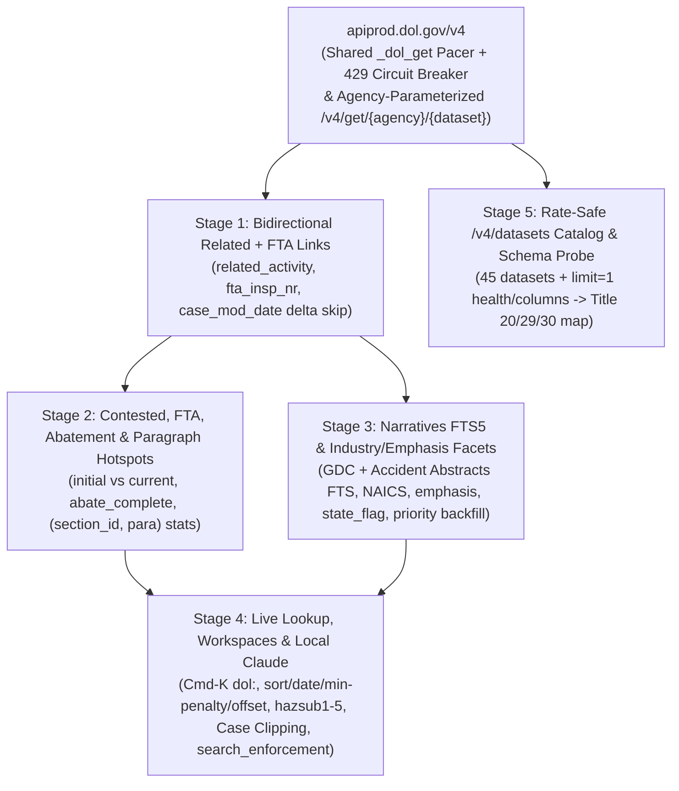

# Master Plan 42: DOL Open Data API v4 Expansion & Enforcement Intelligence

> **Status:** Completed (`2026-11-18`)  
> **Series:** `40_regulatory_intelligence_and_dol` · Follows [`41_osha_news_interface/`](../41_osha_news_interface/MASTER_PLAN.md)  
> **Created:** 2026-11-17 · **Updated:** 2026-11-18 (API-Key Maximization & Quota Stewardship Revision)  
> **Context / Motivation:** Plan 41 delivered FRAMEWORK's sanctioned Regulatory Newsroom (`#/news`), schedule-gated Federal Register + DOL v4 sync, local `osha_news.sqlite3` storage, and the in-app Inspection Case File (`#/news/inspection/{activity_nr}`). Live probing against `https://apiprod.dol.gov/v4` and an audit of `reader/app/news.py` showed that Plan 41 leaves high-value data already fetched (or reachable with the same free `DOL_API_KEY`) unused—including accident narratives, paragraph-level citation hotspots, emphasis programs, Federal vs. State Plan separation, multi-agency datasets (`WHD`, `EBSA`, `MSHA`, `OWCP`), and cross-links to Workspaces and Claude.

---

## 1. Problem Statement, Scope & Non-Goals

- **Core Problem:** Today, `reader/app/news.py` only scratches the surface of `DOL_API_KEY`: `_dol_get()` hardcodes `/get/OSHA/`, `hazsub4`–`hazsub5` are omitted from queries despite being parsed, `emphasis`/`state_flag`/`abate_complete` sit unused, accident abstracts (`OSHA/accident*`) are invisible to search, `parse_dol_standard()` paragraph precision isn't rolled up to the CFR Reader, and every manual `/enrich` click re-fetches unchanged cases without a shared `429` rate-limiter.
- **In Scope:**
  1. **Cross-Cutting Quota Stewardship & Bidirectional Links (Stage 1):** Shared inter-request rate-pacer + `429` circuit breaker in `_dol_get()`, agency-parameterized `_dol_get(c, key, agency, dataset, params)`, `case_mod_date` skip-unchanged guard on `/enrich`, `hazsub1`–`hazsub5` parity, and bidirectional `OSHA/related_activity` + `fta_insp_nr` case links.
  2. **Contested Reductions, FTA & Paragraph Hotspots (Stage 2):** Initial vs. current settlement reductions, `OSHA/violation_event` revision deltas, Failure-to-Abate (`fta_*`) + open/overdue abatement (`abate_complete` / `abate_date`) flags, and **paragraph-level** `(section_id, para)` citation hotspots inside the CFR Reader.
  3. **Unified Narratives FTS5, Industry Benchmarks & Core Facets (Stage 3):** Index **both** General Duty `5(a)(1)` (`OSHA/violation_gen_duty_std`) **and** `OSHA/accident*` abstracts/fatalities into `enforcement_narratives_fts`, add `naics_code`, `state_flag` (Federal OSHA vs. State Plan), `fatality`, and `5(a)(1)` primary filters (keeping `emphasis` / `hazcat` as Case File metadata / secondary dropdown rather than top-bar chip sprawl), plus a strictly capped (`<= 5` cases/sync, `429`-aborting) background priority enrichment pass.
  4. **Live Archive Lookup, Workspaces & Local Claude Tool (Stage 4):** Explicit-submit `GET /api/news/dol/search` from `#/news` and `⌘K` (`dol:`)—gated by a 1-call live `filter_object` syntax verification—with `sort_by`, date-range, min-penalty, a lean top-50 `HAZSUB_LABELS` map, and `offset` paging; Workspace clipping from Case Files (`framework_projects_v1`); and a **local-SQLite-only** `search_enforcement` tool in `reader/app/chat.py` explicitly scoped as local sample data.
  5. **CLI-First Multi-Agency Catalog & Schema Probe (Stage 5):** Rate-safe `/v4/datasets` CLI crawler (`python -m app.dol_catalog --probe`) paired with a spaced `limit=1` health (`200` vs `500`) and schema probe writing `dol_datasets` and `DOL_CATALOG_INVENTORY.md`—deferring any Settings/News catalog UI until Plan 43+ integrates WHD/EBSA/MSHA/OWCP.
- **Out of Scope (Non-Goals):**
  - Scraping `osha.gov` / `dol.gov` HTML, RSS, or letters of interpretation, or bypassing CAPTCHAs.
  - Firing live DOL API calls on keystrokes (`input`), hover peeks, or `GET` page renders (beyond explicit user-submitted Stage 4 search or scheduled/manual sync).
  - Querying upstream `HTTP 500` datasets (`OSHA/optional_info`, `OSHA/history`, `OSHA/strategic_codes`) unless live probing verifies upstream recovery.
  - Letting Claude's chat tool make live network requests to `apiprod.dol.gov` (Claude reads `osha_news.sqlite3` only).
  - Re-opening locked UI contracts (`AGENTS.md` Rule 9; `statPill()` strictly for sync/download state; dark-only UI).

---

## 2. Key Decisions & Rationales (Brainstorming Outcome)

| Decision Point | Option Chosen | Alternatives Considered | Rationale / Trade-offs |
| :--- | :--- | :--- | :--- |
| **Rate-Limit & `429` Protection** | Shared `_dol_get()` pacer + `Retry-After` circuit breaker + `case_mod_date` skip-unchanged guard + 10m Stage 4 TTL cache | Per-endpoint ad-hoc `sleep()` and blind `/enrich` re-fetches | Background worker, `/enrich`, Stage 4 lookup, and Stage 5 discovery share one API key quota; centralizing prevents concurrent bursts and redundant calls. |
| **Non-OSHA DOL Readiness** | Parameterize `_dol_get(c, key, agency, dataset, params)` now + CLI-only `limit=1` schema probe in Stage 5 | Hardcode `/get/OSHA/` or build Settings catalog UI before Plan 43+ | FRAMEWORK already reads all 50 CFR titles; CLI probing verifies real `200 OK` vs `500` datasets without adding premature UI or snapshot surface. |
| **Narrative Full-Text Index** | Single `enforcement_narratives_fts` FTS5 table indexing both GDC `5(a)(1)` lines and `OSHA/accident*` abstracts | Index `gdc_fts` only; ignore `accidents_json` | `fetch_inspection_case()` already downloads accident abstracts and fatality causes; indexing both unlocks real hazard/incident search for zero extra API calls. |
| **Reader Enforcement Insights** | Roll up `(section_id, para)` raw counts (with `%` gated at `>= 10` hits) + filter `state_flag` separately | Show `%` on tiny samples; mix State Plan codes into federal metrics | Prevents small-sample false precision on local DBs while keeping Federal Title 29 counts accurate and falling back gracefully to section pages. |
| **Background Enrichment** | Strictly capped trickle (`<= 5` priority `A`/`M` or `5(a)(1)` cases per sync, abort on `429`) | Never enrich until clicked vs. enrich 10–150 cases per sync (`429` quota burn) | Populates `related_json` and `enforcement_narratives_fts` for highest-signal cases without exhausting burst quota ahead of Stage 4 search. |
| **Claude & Workspaces Bridge** | Clip Case Files to `framework_projects_v1` + local-only `search_enforcement` labeled as local sample | Let Claude hit live DOL API or present local counts as national rates | Connects real OSHA penalties directly to CFR research while keeping Claude immune to `429`s and honest about local sample scope. |

---

## 3. Foundation Already Shipped (Plan 41 Baseline)

Do not re-implement these primitives; extend them cleanly:

- **Backend client & parsers (`reader/app/news.py`):**
  - `_dol_get()` passing `?X-API-KEY=` via query params (header-only auth returns `401`), returning `[]` on `HTTP 204`, and stripping secrets (`from None`) in `SourceUnavailable`.
  - `DOL_INSP_BATCH = 50` chunking `in` queries under the ~2 KB API Gateway URL ceiling.
  - `parse_dol_standard()` decoding IMIS strings (e.g. `"19101030 G02   IIA"` → `section="1910.1030"`, `para="(g)(2)(ii)(A)"`).
  - `build_enforcement_article()` and `fetch_inspection_case()` querying `OSHA/inspection`, `OSHA/violation`, `OSHA/violation_event`, `OSHA/violation_gen_duty_std`, `OSHA/accident`, `OSHA/accident_injury`, and `OSHA/accident_abstract`.
- **SQLite Store (`reader/app/news_store.py`):**
  - `osha_news.sqlite3` (`SCHEMA_VERSION = 2` via `PRAGMA user_version`, WAL writes + `mode=ro` `query_only=ON` read path via `connect(readonly=True)`).
  - Tables: `articles`, `article_citations`, `articles_fts` (porter unicode61), `sync_status`, and `enforcement_cases` (`activity_nr`, `details_json`, `violations_json`, `events_json`, `gdc_json`, `accidents_json`, `enriched_at`, `fetched_at`).
  - Helpers: `save_enforcement_case()`, `get_enforcement_case()`, `enforcement_summary()`.
- **HTTP API (`reader/app/routers/news.py`):**
  - `news_router` mounted before `title_router`.
  - Existing routes: `GET /api/news`, `/status`, `/facets`, `/refresh`, `/section/{id}`, `/part/{part}`, `/enforcement/summary`, `/inspection/{activity_nr}`, and `POST /api/news/inspection/{activity_nr}/enrich`.
- **Frontend (`reader/frontend/src/`):**
  - `views/news.ts` + `views/news_case.ts`: `enforcementSummaryHtml()`, `loadInspection()`, `renderInspectionCase()`, `enrichInspection()`.
  - `components/news_activity.ts`, `views/core.ts`, `router.ts`: `#/news/inspection/{activity_nr}` routing.
  - `components/search_bar.ts` + `components/palette.ts` + `core/projects_store.ts`: global `⌘K` bar with `>` command mode and `framework_projects_v1` Workspaces.

---

## 4. Verified Live DOL API v4 Constraints & Ground Truth

Recorded from live probes on 2026-11-16 and 2026-11-17:

| Finding | Observed Behavior | Design Implication in Plan 42 |
| :--- | :--- | :--- |
| **Gateway Auth** | Header-only `X-API-KEY` returns `401`; query param `?X-API-KEY=` returns `200`. | Route all DOL calls through `_dol_get()`; never log full URLs or keys. |
| **Strict Burst Rate Limit** | Rapid consecutive requests trigger **`HTTP 429`**. | Shared inter-request pacer + `429` cooldown in `_dol_get()`; Stage 4 explicit-submit only + 10m TTL cache; paced Stage 5 probing. |
| **GET URL Size Ceiling** | `~2 KB` limit (`url_len=2295` triggers `403`). | Keep `in` filters `<= 50` IDs (`DOL_INSP_BATCH`) and compact `fields` lists. |
| **Empty Window Responses** | No matching rows returns `HTTP 204 No Content` with empty body. | Already handled as `[]` in `_dol_get()`. |
| **Healthy `200 OK` Datasets** | `OSHA/inspection` (36 fields), `OSHA/violation` (29 fields), `OSHA/violation_event`, `OSHA/violation_gen_duty_std`, `OSHA/related_activity`, `OSHA/accident`, `OSHA/accident_injury`, `OSHA/accident_abstract`, `/v4/datasets`. | Safe to build against; all fixtures mirror real schemas. |
| **Failing Upstream Datasets** | `OSHA/optional_info`, `OSHA/history`, `OSHA/strategic_codes` returned **`HTTP 500`**. | **Explicitly excluded** unless live Stage 5 probes record recovery. |
| **Catalog Scope** | `/v4/datasets?limit=200` reported `meta.total_count: 45` (observed `OWCP_energy_statistics_weekly_20260101_present` before burst `429`). | Do not hardcode unverified non-OSHA slugs; Stage 5 catalogs + `limit=1`-probes all 45 safely. |

---

## 5. Architecture & Component Changes

- **Affected Files & Modules:**
  - `reader/app/news.py`: Shared `_dol_get()` rate-pacer & `429` cooldown, `agency` parameterization (default `"OSHA"`), `hazsub1`–`hazsub5` fetch parity + label lookup, `case_mod_date` delta guard, bidirectional `OSHA/related_activity`, reduction/FTA/abatement metrics, and Stage 4 `search_dol_inspections()` / `search_dol_violations()`.
  - `reader/app/news_store.py`: Non-destructive `SCHEMA_VERSION` `2 -> 3` migration (or idempotent `ALTER TABLE` preserving existing rows and updating `connect(readonly=True)`), `related_json`, `enforcement_narratives_fts` (GDC + accident narratives), `paragraph_enforcement_stats()`, `naics_summary()`, `emphasis`/`state_flag`/`fatality` facet queries, and `dol_datasets` catalog table.
  - `reader/app/news_worker.py`: Low-rate idle trickle enrichment for priority synced inspections (`general_duty > 0`, `insp_type` `A`/`M`, top penalties).
  - `reader/app/routers/news.py`: Extended `/enforcement/summary`, `/section/{id}`, `/part/{part}`, `/facets`, `/api/news` filters (`naics`, `gdc`, `fatality`, `state_flag`, `emphasis`), plus `/api/news/enforcement/naics/{code}` and `/api/news/dol/search`.
  - `reader/app/dol_catalog.py`: CLI-first Stage 5 `/v4/datasets` crawler + `limit=1` probe writing `dol_datasets` and `DOL_CATALOG_INVENTORY.md` (no frontend catalog UI yet).
  - `reader/app/chat.py`: Local-only `search_enforcement` tool reading `osha_news.sqlite3`.
  - `reader/frontend/src/views/news.ts`, `news_case.ts`, `components/news_activity.ts`, `components/search_bar.ts`, `components/palette.ts`, `core/projects_store.ts`, `styles/10_news.css`.

---

## 6. Phased Stage Roadmap

### Stage 1: Quota Foundation & Bidirectional Related Inspections ([`stage-1_related_inspections_graph/`](stage-1_related_inspections_graph/README.md))
- [ ] Add shared `_dol_get()` inter-request pacer, `Retry-After` `429` circuit breaker, and `agency` parameterization (`agency="OSHA"` default) in `news.py`; fetch `hazsub1`–`hazsub5` consistently.
- [ ] Add non-destructive schema migration (`related_json` on `enforcement_cases`) while keeping `connect(readonly=True)` and existing cached cases intact (`SCHEMA_VERSION` `2 -> 3` upgrade).
- [ ] Skip redundant `/enrich` upstream fetches only when cached `case_mod_date` matches **and** expected Stage 1+ sub-fields (`related_json`) are already populated (unless `force=true`).
- [ ] Query `OSHA/related_activity` bidirectionally (`activity_nr` & `rel_act_nr`), surface `fta_insp_nr` companion links, and render `inspectionRelatedHtml()` on `#/news/inspection/{activity_nr}`.
- **Exit Criteria / Checkpoint:** Offline `FakeAPI` tests verify `429` cooldown sharing, complete-row `case_mod_date` cache hit vs. legacy partial-row upgrade, and `#/news/inspection/{A}` → `{B}` navigation.

### Stage 2: Contested Reductions, Abatement & Paragraph Hotspots ([`stage-2_contested_and_fta_analytics/`](stage-2_contested_and_fta_analytics/README.md))
- [ ] Compute `initial_total`, `current_total`, `reduction_usd`, `reduction_pct`, `contested_count`, `fta_count`, `fta_total_usd`, and open/overdue `abate_complete` counts; pair `violation_event` history to `citation_id`.
- [ ] Aggregate `(section_id, para)` citation hotspots from `parse_dol_standard()` in `news_store.py` alongside `section_enforcement_stats()` and `part_enforcement_stats()` (displaying raw counts by default, gating `%` share behind `>= 10` citations, with clean section-level fallback when an IMIS anchor isn't present in DOM).
- [ ] Expose additive `stats` + `top_paragraphs` on `/api/news/section/{id}`, `/part/{part}`, and `/enforcement/summary`; render hairline reduction/FTA/abatement tags and top-cited paragraph cues in `#btn-news-activity` popover and Case Files.
- **Exit Criteria / Checkpoint:** Unit tests verify zero division-by-zero on `$0` initial penalties, small-sample raw-count vs. `>= 10` `%` gating, `test_api_snapshots.py`, and `test_news_frontend.py` (`statPill` guard).

### Stage 3: Narratives FTS5 (GDC + Accidents), Benchmarks & Core Facets ([`stage-3_naics_and_general_duty_index/`](stage-3_naics_and_general_duty_index/README.md))
- [ ] Build `enforcement_narratives_fts` (FTS5 `porter unicode61`) indexing **both** `OSHA/violation_gen_duty_std` `5(a)(1)` text and `OSHA/accident*` abstracts/`fat_cause`/`event_keyword`, kept in sync during `news_store.prune()`.
- [ ] Add `naics_summary()`, Federal vs. State Plan (`state_flag`), `fatality`, and `5(a)(1)` primary filters (`emphasis`/`hazcat` surfaced in Case File metadata and secondary dropdown rather than top-bar chip sprawl).
- [ ] Add strictly capped spaced priority background enrichment in `news_worker.py` (`<= 5` high-signal `A`/`M` or `5(a)(1)` cases per sync, aborting immediately on `429`).
- [ ] Render interactive NAICS, `5(a)(1)`, Fatality, and Federal/State Plan filter chips on `#/news?cat=enforcement` with deep links back to `29 CFR` sections.
- **Exit Criteria / Checkpoint:** FTS queries return `\x02`/`\x03` snippets across both GDC and accident narratives; `prune()` cleans FTS rows; `state_flag` separates state-plan codes from federal Title 29 stats; worker trickle aborts on `429`.

### Stage 4: Live DOL Lookup, Workspaces & Local Claude Tool ([`stage-4_live_dol_lookup/`](stage-4_live_dol_lookup/README.md))
- [ ] Run a 1-call live verification of DOL v4's `filter_object` string/prefix operator (`like` vs `eq`) on `estab_name` and `standard` before finalizing query builders.
- [ ] Implement `GET /api/news/dol/search` (employer, NAICS, CFR standard, `hazsub1`–`hazsub5` with a lean top-50 `HAZSUB_LABELS` map, state, date range, min penalty, `sort_by`, `offset` pagination) behind explicit submit + 10m TTL LRU cache + `429` cooldown.
- [ ] Wire `dol:` prefix + `>` command entry in `⌘K` (`search_bar.ts` / `palette.ts`) and live archive search bar + `"Load next 25"` in `#/news?cat=enforcement`, auto-saving opened results to `enforcement_cases`.
- [ ] Add **"Clip Case to Workspace"** on `#/news/inspection/{activity_nr}` storing structured case summaries/citations into `framework_projects_v1`.
- [ ] Add a **local-only** `search_enforcement` tool in `reader/app/chat.py` querying `osha_news.sqlite3`, clearly labeling returned rows as a local cached sample rather than national OSHA rates.
- **Exit Criteria / Checkpoint:** Typing `dol: ...` fires 0 HTTP calls until `Enter`; repeated queries hit cache; Workspace export preserves clipped cases; `chat.py` tool tests verify local-sample disclaimer and 100% offline execution.

### Stage 5: CLI-First `/v4/datasets` Catalog & Schema Probe ([`stage-5_dol_catalog_discovery/`](stage-5_dol_catalog_discovery/README.md))
- [ ] Implement resumable, paced `fetch_dol_catalog()` over `GET /v4/datasets` plus an opt-in CLI `limit=1` probe (`python -m app.dol_catalog --probe`) recording live health (`200` vs `500`) and real column names.
- [ ] Persist `dol_datasets` (`slug`, `agency`, `title`, `frequency`, `probe_status`, `fields_json`, `cfr_title`, `cfr_parts_json`) in `osha_news.sqlite3` and generate `DOL_CATALOG_INVENTORY.md` mapping **WHD**, **EBSA**, **MSHA**, **OWCP**, and **OSHA** to Title 20 / 29 / 30 CFR parts (deferring any Settings/News catalog UI until Plan 43+).
- **Exit Criteria / Checkpoint:** Offline `FakeAPI` tests verify multi-page collection, `429` partial-save recovery, `limit=1` status/schema recording, and zero key leakage.

---

## 7. Risk Assessment & Mitigations

| Risk | Mitigation |
| :--- | :--- |
| **`HTTP 429` lockouts across overlapping features** | Single shared rate-pacer + cooldown state in `_dol_get()`, `case_mod_date` skip guard, 10m Stage 4 cache, and explicit-submit-only UI triggers. |
| **Upstream `filter_object` syntax surprises (`like` vs `eq`)** | Run a single manual live probe for string/IMIS prefix filtering before finalizing Stage 4 query builders; record exact operator in `DOL_CATALOG_INVENTORY.md`. |
| **SQLite schema mismatch breaking `connect(readonly=True)`** | Keep `SCHEMA_VERSION` synchronized between `connect(readonly=True)` and `connect(readonly=False)` using non-destructive migrations that never drop `enforcement_cases`. |
| **State Plan codes polluting Federal CFR benchmarks** | Filter and label `state_flag` distinctly in `news_store.py` queries so state-specific standards don't distort federal Title 29 averages. |
| **Frontend bundle or CSS token drift** | Rebuild `reader/static/dist/` (`npx tsc --noEmit && npm run build`) after every stage; verify `test_build_stamp.py` and `test_news_frontend.py`. |

---

## 8. Verification & Definition of Done (DoD)

- [ ] All non-browser & Playwright suites pass offline (`cd reader && REQUIRE_BROWSER=1 ../.venv/bin/python -m pytest tests -q`).
- [ ] Frontend typecheck and unit tests pass (`cd reader/frontend && npx tsc --noEmit && npm test`) and `reader/static/dist/` matches `build-stamp.json`.
- [ ] `tests/snapshots/route_inventory.json`, `tests/test_api_snapshots.py`, `reader/API.md`, `CLAUDE.md`, and `docs/plans/README.md` are updated and clean.
- [ ] Zero raw `#hex` colors in `10_news.css`, zero forbidden Unicode/emoji glyphs, zero `statPill()` misuse, and zero `DOL_API_KEY` leakage in logs/errors/snapshots.
