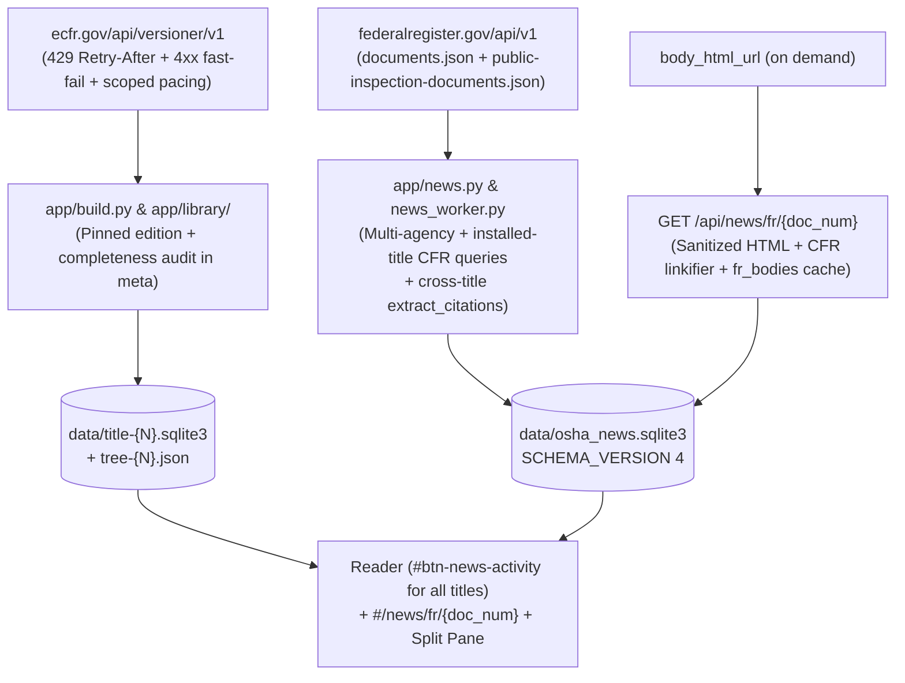

# Master Plan 43: Federal Register Expansion & eCFR Ingestion Hardening

> **Status:** Completed (`2026-11-18`, macOS baselines current)  
> **Series:** `40_regulatory_intelligence_and_dol` · Follows [`42_dol_api_expansion/`](../42_dol_api_expansion/MASTER_PLAN.md)  
> **Created:** 2026-11-18  
> **Context / Motivation:** FRAMEWORK already ingests Federal Register metadata (`documents.json` and `public-inspection-documents.json`) in `reader/app/news.py`, and ingests all 50 CFR titles via the eCFR Versioner API v1 in `reader/app/build.py`. However, Federal Register coverage is currently constrained to a single OSHA agency slug, Title 29-only citation extraction, and abstracts without full-text rule/preamble reading; meanwhile, eCFR ingestion lacks `429 Retry-After` pacing, short-circuits `4xx` retries poorly, silently skips unmatched XML leaves, and can drift across editions during scoped/cached downloads.

---

## 1. Problem Statement, Scope & Non-Goals

- **Core Problem:**
  1. **Federal Register under-utilization:** `news_worker.sync_sources()` only reads `config.news_agencies()[0]` (defaulting to OSHA), `news.extract_citations()` discards all non-Title 29 citations, `news_activity.ts` disables `#btn-news-activity` for every title except `29`, and `body_html_url` (fetched in `FR_FIELDS`) is never rendered or searchable for reading final/proposed rule preambles inside the app.
  2. **eCFR ingestion edge-case fragility:** `build.fetch_json()` and `build.download_stream()` retry blindly on fixed `2s/4s/6s` sleeps without honoring `HTTP 429 Retry-After` or pacing multi-request `scope` downloads (`?part=`/`?section=`/`?appendix=`), retry non-transient `4xx` responses (e.g. `404`), silently drop unmatched structure leaves with only a console log, and leave no completeness audit in `meta`.

- **In Scope:**
  1. **eCFR Ingestion & Library Hardening (Phases 1–2):**
     - Shared eCFR HTTP client resilience (`429 Retry-After` cooldown/backoff, non-retryable `4xx` fast-fail, gentle pacing on scoped multi-piece builds).
     - Edition pinning across `structure()` and `build()`, plus non-silent `missing_leaves` / completeness tracking in `meta` and hard failure when a requested partial scope yields zero matched leaves.
     - Orphan `.download`/`.tmp` cleanup hardening and explicit server-reload or cache-invalidation ergonomics for CLI builds (`POST /api/library/reload` or clear status surfacing).
  2. **Multi-Title & Multi-Agency Federal Register Sync (Phase 3):**
     - Multi-agency (`NEWS_AGENCIES`) and installed-CFR-title (`conditions[cfr][title][]=...`) FR sync in `news.py` / `news_worker.py` with `guid = fr:{document_number}` deduplication.
     - Cross-title citation extraction (`29`, `40`, `49`, and any title `1–50`) in `news.extract_citations()`, multi-title `article_citations` queries, and unlocking `#btn-news-activity` across all installed titles in `news_activity.ts`.
     - Title/agency filtering in `#/news` and per-title FR pulse counts on `/api/titles/snapshot`.
  3. **On-Demand Federal Register Full-Text Reader (Phase 4):**
     - Lazy fetch, HTML sanitization, citation linkification, and SQLite caching (`fr_bodies` in `news_store.py`, `SCHEMA_VERSION` `3 -> 4`) for `body_html_url` documents.
     - In-app FR Document View (`#/news/fr/{document_number}`) and `Alt+Click` split-pane pairing alongside the CFR sections being amended.

- **Out of Scope (Non-Goals):**
  - Ingesting `https://www.federalregister.gov/api/v1/documents.rss` into FRAMEWORK (the RSS feed omits `document_number`, `cfr_references`, `effective_on`, `comments_close_on`, `docket_ids`, and `body_html_url`, and caps at 200 items; the JSON API v1 already in `news.py` strictly supersedes it).
  - Bulk downloading multi-year GovInfo FR XML archives (`govinfo.gov/bulkdata/FR`) or scraping `ecfr.gov` / `federalregister.gov` HTML pages outside documented API endpoints.
  - Background auto-downloading full CFR title XMLs without user action (staleness detection remains opt-in / UI-triggered via `#/library`).
  - Modifying locked reader UI contracts (`AGENTS.md` Rule 9; `statPill` reserved strictly for sync/download state).

---

## 2. Key Decisions & Rationales (Brainstorming Outcome)

| Decision Point | Option Chosen | Alternatives Considered | Rationale / Trade-offs |
| :--- | :--- | :--- | :--- |
| **FR Ingestion Endpoint** | Keep & expand `FR API v1` (`documents.json` + `public-inspection-documents.json`) | Switch to `documents.rss` or bulk GovInfo FR XML | `documents.json` provides structured `cfr_references`, `effective_on`, `comments_close_on`, `docket_ids`, and `body_html_url` with zero API key; `documents.rss` strips all of those fields. |
| **Multi-Title FR Scoping** | Sync configured `NEWS_AGENCIES` **plus** `conditions[cfr][title][]` for installed CFR titles, deduplicated by `fr:{document_number}` | Hardcode a fixed list of 50 agency slugs or fetch the entire daily FR firehose | Scoping to installed titles + configured agencies keeps local `osha_news.sqlite3` focused and fast while supporting Title 40 (EPA), Title 49 (DOT), etc. automatically. |
| **FR Full-Text Preambles** | Lazy fetch + sanitize + cache `body_html_url` on demand when opened (`#/news/fr/{doc_num}`) | Eagerly download and store every FR article's HTML body during background sync | Avoids multi-hundred-MB DB bloat and unnecessary upstream requests while giving full preamble reading and CFR cross-linking when needed. |
| **eCFR Update Strategy** | Keep atomic full-edition rebuilds at a pinned `up_to_date_as_of` date, with `429` pacing + completeness checks | Incremental section-by-section XML patching from `/versions/title-{N}.json` | Full-edition builds guarantee structural/ordering consistency (`ord`, `front_matter`, `title_graph`) without partial-patch drift; adding `429` backoff and pinned editions solves the real failure modes. |
| **eCFR Completeness Policy** | Record `missing_leaves` in `meta` and fail partial builds with 0 matches (or whole builds above a threshold) | Continue silently logging warnings when structure nodes lack XML | Prevents silent gaps in regulatory text (especially on scoped micro-downloads) from looking like complete installs. |

---

## 3. Architecture & Component Changes

- **Affected Backend Files:**
  - `reader/app/build.py`: Shared `_ecfr_get` / retry classifier (`429 Retry-After`, no retry on `400`/`404`/`410`, scoped request pacing), `edition` parameter pass-through, `missing_leaves` metadata persistence, and empty-match guard.
  - `reader/app/library/client.py`, `reader/app/library/jobs.py`, `reader/app/library/disk.py`: Pin edition between `structure()` and `build()`, clean orphan `.download` / `.tmp` artifacts on startup or cancellation.
  - `reader/app/ingest/parse.py`, `reader/app/ingest/tree.py`: Defensive handling of malformed/empty XML fragments and updated quirk logging in `docs/bugs,quirks/README.md`.
  - `reader/app/news.py`, `reader/app/news_worker.py`: Multi-agency iteration + installed-title `conditions[cfr][title][]` sync, cross-title `extract_citations()`, and `fetch_fr_body(c, body_html_url)`.
  - `reader/app/news_store.py`: Non-destructive `SCHEMA_VERSION` `3 -> 4` migration adding `fr_bodies` cache table (`document_number`, `body_html`, `fetched_at`) with retention pruning, plus title-scoped queries (`title` parameter on `articles_for_section` / `articles_for_part`).
  - `reader/app/routers/news.py`, `reader/app/routers/library.py`: Title-aware `/api/news/section/{id}?title=`, `/api/news/part/{part}?title=`, new `GET /api/news/fr/{document_number}`, and optional `POST /api/library/reload` (or local-only refresh hook).
- **Affected Frontend Files:**
  - `reader/frontend/src/components/news_activity.ts`: Remove `titleNum !== 29` guard; query with `state.currentTitle` and link to `#/news/fr/{doc_num}` / `#/news?title=...`.
  - `reader/frontend/src/views/news.ts` & new `reader/frontend/src/views/news_fr.ts` (or extension of `news_case.ts`): Title/agency filter pills on `#/news`, FR preamble reader view (`#/news/fr/{document_number}`), and `Alt+Click` split-pane support.
  - `reader/frontend/src/core/news_format.ts`, `reader/frontend/src/router.ts`, `reader/frontend/src/api/client.ts`: Typed DTOs (`FrBodyResponse`), route registration, and sanitized rendering (`DOMPurify` + `safeHttpUrl`).

---

## 4. Phased Implementation Roadmap

### Phase 1: eCFR HTTP Resilience & Edition Pinning
- [x] Extract a shared HTTP retry helper in `reader/app/build.py` (used by `fetch_json`, `download_stream`, and `library/client.py` / `library/views.py`): honor `429 Retry-After` (capped backoff), fail immediately on non-transient `4xx` (`400`, `404`, `410`), and pace multi-piece `scope` downloads.
- [x] Pass explicit `edition` from `library/jobs.py` into `build.build(edition=...)` so structure inspection and XML download cannot straddle a daily edition rollover.
- [x] Persist `missing_leaves` count/sample in `meta` inside `build.py`; fail builds when a partial `scope` matches zero XML leaves or when missing non-reserved leaves exceed a configurable threshold.
- **Exit Criteria / Checkpoint:** Hermetic `httpx.MockTransport` tests verify `429 Retry-After` waiting, immediate `404` abort without sleep retries, pinned edition usage, and zero-match failure.

### Phase 2: eCFR Disk Hygiene, Quirk Verification & Reload Boundary
- [x] Extend `library/disk.py` to prune orphaned `*.download` and stale `*.tmp` files on startup / job cleanup without touching active swaps.
- [x] Audit `ingest/parse.py` and `ingest/tree.py` against a wider set of CFR titles (e.g., Titles 14, 21, 29, 40, 47, 49) and document any newly observed XML/structure anomalies in `docs/bugs,quirks/README.md`.
- [x] Add clean cache/handle release (`POST /api/library/reload` or `library.disk.installed()` reconciliation) so CLI `python -m app.build` runs can be picked up without a full server restart if triggered.
- **Exit Criteria / Checkpoint:** Non-browser pytest suite passes (`tests/test_library.py`, `tests/test_units.py`, `tests/test_api_snapshots.py`); no leftover `.tmp`/`.download` files after cancelled or failed builds.

### Phase 3: Multi-Title & Multi-Agency Federal Register Sync
- [x] Update `news_worker.sync_sources()` to iterate over all configured `config.news_agencies()` **and** optionally query `conditions[cfr][title][]` for installed CFR titles (`config.installed_titles()`), deduplicating by `guid = fr:{document_number}`.
- [x] Generalize `news.extract_citations()` to extract `title_num`, `part_id`, and `section_id` across all titles `1–50` using `citations/parser.py` (`CROSS_TITLE_*` patterns), keeping bare `§` `1900–1999` scoped to OSHA/Title 29 context.
- [x] Update `news_store.py` and `routers/news.py` (`summary_for_title`, `/api/news` `title` filter, `/section/{id}`, `/part/{part}`) and remove the `titleNum !== 29` gate in `components/news_activity.ts`.
- **Exit Criteria / Checkpoint:** `FakeAPI` + `FakeTitles` tests confirm Title 40 (EPA) and Title 49 (DOT) FR rules link to `#/title/40/section/...` and `#/title/49/section/...`, populate `#btn-news-activity`, and update `/api/titles/snapshot` without duplicating existing Title 29 rows.

### Phase 4: On-Demand Federal Register Full-Text Reader (`body_html_url`)
- [x] Add `fr_bodies` cache table in `news_store.py` (`SCHEMA_VERSION` `3 -> 4` non-destructive `ALTER`/DDL upgrade keeping `connect(readonly=True)` safe) with retention pruning aligned to `retention_days()`.
- [x] Add `news.fetch_fr_body()` and `GET /api/news/fr/{document_number}` in `routers/news.py`: fetch `body_html_url` only when requested (with `SourceUnavailable` / `404` handling), sanitize HTML, and run CFR/USC/FR citation linkification.
- [x] Build `#/news/fr/{document_number}` frontend view (`news_fr.ts`), integrate into `news.ts` cards and `news_activity.ts` popovers, and support `Alt+Click` split-pane reading alongside the CFR section being amended.
- **Exit Criteria / Checkpoint:** Offline tests verify `fr_bodies` caching, XSS sanitization (DOMPurify + backend allowlist), citation linkification, `npx tsc --noEmit`, `npm test`, `npm run build`, and `test_build_stamp.py`.

---

## 5. Risk Assessment & Mitigations
- **Risk:** Querying both `NEWS_AGENCIES` and multiple `conditions[cfr][title][]` titles increases FR API pagination volume on first sync.
  - *Mitigation:* Cap pagination (`FR_MAX_PAGES`), share one `httpx.Client` per sync, and deduplicate by `fr:{document_number}` before upserting into `articles` / `articles_fts`.
- **Risk:** `body_html_url` HTML from Federal Register contains complex tables, footnotes, or unexpected tags.
  - *Mitigation:* Sanitize strictly on both backend (allowlist/stripping scripts & inline handlers) and frontend (`DOMPurify`), and reuse the existing `.reg-prose` / horizontal table scroll styles.
- **Risk:** Modifying `routers/news.py` or `/api/titles/snapshot` shapes breaks golden snapshots (`tests/snapshots/`).
  - *Mitigation:* Keep existing response keys additive/backward-compatible; review diffs carefully before running `UPDATE_SNAPSHOTS=1` for intended additions, and verify `news_router` stays mounted before `title_router`.

---

## 6. Verification & Definition of Done (DoD)
- [x] Automated tests pass (`npm test` / `pytest` / etc.)
- [x] Type checks and linters clean
- [x] User review / sign-off on behavior (pending final check run)
