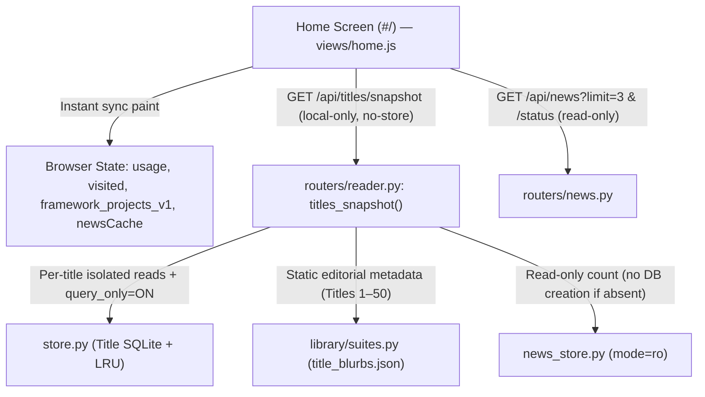

# Master Plan: End-User Home Screen Refactor & Backend Stability

## Executive Summary

This master plan refactors **FRAMEWORK**'s primary Home screen (`#/`) around **non-developer end users** (compliance managers, EHS directors, safety leads, legal/regulatory researchers) while hardening backend SQLite concurrency, cache isolation, job thread-safety, and fault tolerance.

The current Home screen (`views/home.js`) replaced the original telemetry-only Overview, but still retains developer-facing artifacts (`Import JSON`, `Commands`, `Connections`, `DOL inspection sync is off · Add free DOL key`, `Connect Claude`, a second search box duplicating the topbar) and pushes **Installed Titles** below the `1280×800` fold. This plan strips away redundant utility chrome, elevates **Workspaces** alongside **Continue Reading** in Band 1, brings **Downloaded Titles** above the fold as a living local snapshot in Band 2, condenses **Regulatory Pulse** into a quiet Band 3 digest, and reinforces the Python backend paths serving Home, search, library builds, and news reads.

---

## Official Documentation & Technical References

All backend and frontend hardening decisions in this plan follow documented platform guarantees:

1. **SQLite WAL, Read-Only Mode & Busy Contention (`sqlite.org`)**:
   - *WAL + Read-Only Connections*: Opening a WAL-mode database (`osha_news.sqlite3`) with `?mode=ro` enforces OS-level read-only access and skips write locks, **provided** `PRAGMA busy_timeout` is configured on every connection—because the default timeout is `0` ms, and a newly opened reader can still collide with a writer's final WAL checkpoint/cleanup (`SQLITE_BUSY`).
   - *Query-Only & File Sidecars*: Title databases (`title-{N}.sqlite3`) are built in DELETE journal mode and read-only at runtime. Setting `sqlite3.connect(..., timeout=5.0)` + `PRAGMA busy_timeout = 5000` + `PRAGMA query_only = ON` prevents accidental mutations and avoids creating `-wal`/`-shm` sidecar files on read paths.
2. **Python `sqlite3` URI Handling & `functools.lru_cache` (`docs.python.org`)**:
   - *Windows & POSIX URI Safety*: `Path.resolve().as_uri()` produces RFC 8089 `file:///` URIs across both POSIX and Windows drive letters (`file:///C:/...`), passed with `uri=True` (`f"{path.resolve().as_uri()}?mode=ro"`). `Path` objects are converted to primitives before crossing cache boundaries.
   - *Failure Caching Trap*: In `store.py`, catching `Exception` and returning a sentinel value (`frozenset()`) inside an `@lru_cache` function (`known_ids`) causes Python to permanently cache that empty result on transient I/O or lock errors. Cacheable lookups must never swallow exceptions into cached return values.
3. **FastAPI Execution Model & Router Precedence (`fastapi.tiangolo.com`)**:
   - *Sync Threadpool vs Event Loop*: Standard `def` route handlers run in AnyIO's worker threadpool (safe for synchronous SQLite calls without blocking the asyncio loop), whereas `async def` handlers must never perform blocking I/O.
   - *Exact Route Precedence*: Fixed paths on `titles_router` (`/api/titles/snapshot`) must be mounted before parameterized `/api/{title}` routers so Starlette never captures fixed words as `{title}` (`422`).
4. **CSS Container Queries & Accessible Responsive UI (`developer.mozilla.org`)**:
   - *Container Containment*: Using `container: hm / inline-size` on `.hm` allows Home layout grids to respond to the reading panel's actual width (even when the sliding drawer or Claude panel is open) rather than viewport width alone.
   - *Accessible Controls*: Decorative SVG icons carry `aria-hidden="true"`; interactive icon/compact buttons always preserve explicit accessible names (`aria-label`), and animations honor `prefers-reduced-motion`.

---

## Core Architectural Decisions

| # | Area | Decision |
| :- | :--- | :--- |
| 1 | **Offline-First Guarantee** | Home (`#/`) **never** triggers external HTTP calls to eCFR, Federal Register, or DOL on load. All data comes from local SQLite DBs, `title_blurbs.json`, and `localStorage`. |
| 2 | **Local Snapshot API** | Keep `GET /api/titles` strictly unchanged (preserving `tests/snapshots/get_titles.json`). Add `GET /api/titles/snapshot` (`Cache-Control: no-store`) for rich local per-title metadata (`agencies`, `summary`, `desk`, `scope_parts`, Title 29 local news count). |
| 3 | **3-Band End-User Layout** | **Band 1**: Active Work (`Continue Reading` 58% \| `Workspaces` 42%) → **Band 2**: Downloaded Titles Living Snapshot (above the fold) → **Band 3**: Regulatory Pulse compact digest. |
| 4 | **Zero Developer Jargon** | Remove `#hm-jump-input`, `Commands`, `Connections`, `Import JSON`, `Connect Claude` setup card, and `DOL inspection sync is off` footer from Home. Global Search (`⌘K`) and Ask Claude (`⌘J`) remain consistent in the topbar; key setup lives in `#/settings` and `#/help`. |
| 5 | **Per-Title Fault Isolation** | One corrupt or mid-swap `title-{N}.sqlite3` must never cause `/api/titles` or `/api/titles/snapshot` to fail with HTTP 500 for other installed titles. |

### Out of Scope for This Plan
- Adding new features to Workspaces (`#/projects`) beyond existing pin/note/tag management.
- Automatic background downloads or eCFR catalog network fetches on Home load.
- Multi-agency News expansion (EPA/PHMSA) in `news_worker.py` (stays Title 29 / OSHA).
- TypeScript `checkJs` migration or ES module cycle refactoring (`docs/notes/2026-11-16_pre-feature-orders.md` Order 3 remains separate).

---

## Architecture & Data Flow



---

## Directory Hierarchy & Build Order

```
docs/plans/home_screen_refactor/
├── MASTER_PLAN.md
├── stage-1_backend_stability_and_snapshot_api/
│   └── README.md
├── stage-2_end_user_home_ui_polish/
│   └── README.md
└── stage-3_verification_baselines_and_docs/
    └── README.md
```

### Execution Order
1. **Stage 1 — Backend Stability & Local Snapshot API**: Harden `store.py`, `news_store.py`, `library/jobs.py`, `routers/reader.py`, and `routers/news.py`; add `GET /api/titles/snapshot`; add backend stability unit tests and snapshots.
2. **Stage 2 — End-User Home UI Polish**: Refactor `views/home.js` and `styles/05_home_overview_lib.css` to the 3-band layout driven by `/api/titles/snapshot`, removing developer chrome and lifting Downloaded Titles above the fold; rebuild `reader/static/dist/`.
3. **Stage 3 — Verification, Baselines & Documentation Sync**: Update `test_browser_parity.py`, clean up `mask.getdata()` deprecation warning, regenerate `darwin` baselines, run full `REQUIRE_BROWSER=1 pytest tests`, and sync `CLAUDE.md` / `reader/API.md`.
