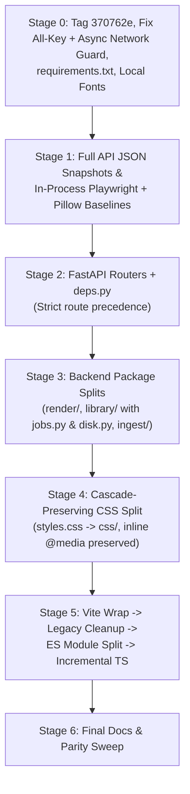

# Master Plan: Repository Structure Stabilization & Modernization

## Executive Summary

This master plan governs the stabilization and modular decomposition of the **FRAMEWORK** repository (`reader/`). It resolves the architectural risks of monolithic files (`reader/static/app.js` at 5,950 lines, `reader/static/styles.css` at 2,066 lines, `reader/app/render.py` at 833 lines, `reader/app/library.py` at 647 lines, `reader/app/build.py` at 593 lines, and `reader/app/main.py` at 453 lines) while enforcing verified pre-flight gates, hermetic test guards, and zero-regression parity checks.

### Binding Architectural Decisions
1. **Committed Fixed-Name `dist/` Bundle**: Vite outputs **fixed, unminified** files (`app.js`, `app.css`, `index.html`, `build-stamp.json`) to `reader/static/dist/`, which are **committed to Git**. Python-only users (including Windows) need **zero Node.js** at runtime, and committed diffs stay readable.
2. **Frontend Dev Loop**: Standardize on `vite build --watch` alongside `uvicorn app.main:app --reload --reload-dir app` so development runs on the exact same single origin and serving path as production.
3. **Plain ES Module Split First -> Incremental TypeScript (Vanilla, No Framework)**:
   - Wrap the untouched `app.js` in Vite first to verify the build pipeline.
   - Split into plain ES modules with a single shared mutable state object (`src/state.js`) and a lightweight nav bridge (`src/nav_bridge.js`), preserving intentional manual DOM updates (transfer dock, `refreshSettingsViews`).
   - Add `tsconfig.json` (`allowJs` + `checkJs`) and convert modules to `.ts` incrementally.
4. **Per-Platform Playwright + Pillow Visual Baselines**: Add Python Playwright tests (`pip` via `requirements-dev.txt`, skipping gracefully if browser binaries aren't installed) running against an in-process background `uvicorn` server, with Pillow pixel-diff baselines per platform (`darwin`, `win32`).
5. **Self-Hosted Fonts in Stage 0**: Host Geist and Inter locally under `reader/static/fonts/` in Stage 0 so Stage 1 screenshot baselines capture the final fonts and never break during Stage 5.
6. **Incremental `CLAUDE.md` Updates**: Update `CLAUDE.md` at the end of every structural stage (Stages 2–5), plus a final sweep in Stage 6, so agent instructions never go stale mid-migration.

---

## Architecture Roadmap



---

## Directory Hierarchy

```
docs/plans/repo_structure_stabilization/
├── MASTER_PLAN.md
├── stage-0_preflight_and_baseline/
│   └── README.md
├── stage-1_snapshots_and_browser_tests/
│   └── README.md
├── stage-2_backend_routers/
│   └── README.md
├── stage-3_backend_package_splits/
│   └── README.md
├── stage-4_css_modularization/
│   └── README.md
├── stage-5_frontend_es_modules_vite_ts/
│   └── README.md
└── stage-6_documentation_sync/
    └── README.md
```

---

## Stage Summaries & Hard Gates

### Stage 0: Pre-Flight & Clean Baseline
- **Baseline Tag**: Tag existing baseline commit `370762e` (`pre-stabilization-baseline`).
- **Hermetic Env & Dual-Transport Network Guard**:
  - Patch **both** `httpx.HTTPTransport.handle_request` and `httpx.AsyncHTTPTransport.handle_async_request` (covering `AsyncAnthropic` in `chat.py:84`).
  - Clear **all 6 `TRACKED_KEYS`** (`DOL_API_KEY`, `ANTHROPIC_API_KEY`, `ANTHROPIC_MODEL`, `NEWS_AGENCIES`, `NEWS_SYNC`, `NEWS_RETENTION_DAYS` from `test_settings_env.py:14`), not just `DOL_API_KEY`.
  - Keep the guard in a shared `unittest.TestCase` base class (not a pytest-only `conftest.py` fixture) so both `pytest` and `python -m unittest discover tests` enforce it, and apply it across **all** test suites (`test_library*`, `test_api_endpoints`, etc.).
- **Pin Dependencies (`requirements.txt` + `requirements-dev.txt`)**: Avoid `pyproject.toml` in `reader/` (which fails setuptools' top-level package discovery across `app/`, `tests/`, `static/`, `data/`, `frontend/`). Put runtime pins in `reader/requirements.txt` and `playwright` + `Pillow` in `reader/requirements-dev.txt` (noting one-time `playwright install chromium`).
- **Self-Host Fonts**: Move Geist & Inter from Google Fonts (`index.html:9-11`) to local woff2 files in `reader/static/fonts/` with `@font-face` rules in `styles.css`.
- **Gate**: All tests pass with a populated `reader/.env`.

### Stage 1: API Snapshots & Browser Parity Harness
- **API JSON Snapshots (`test_api_snapshots.py`)**:
  - Patch `config.ROOT_DIR` (so `/api/settings/env` never reads real `reader/.env`), stub `library.ecfr_titles` and `library.ecfr_title` (for `/api/library` and `/api/library/wire`), and normalize volatile timestamps (`checked_at`, `amended`, `built_at`).
  - Snapshot **every** endpoint: all GET routes (including `/api/news/facets`, `/api/news/section/{id}`, `/api/news/part/{part}`, `/api/{title}/models`), **all POST/DELETE routes**, and **error status shapes** (`404`, `409`, `422`, `503`).
- **In-Process Playwright + Pillow Baselines (`test_browser_parity.py`)**:
  - Launch `uvicorn` on an ephemeral port in a background thread inside the test process (with `NEWS_SYNC=0`) so Python mocks and network guards remain active (`TestClient` does not open a socket).
  - Use `page.clock` (fixed time), seeded `localStorage` (`usage`, `railState`, `framework_projects_v1`), `reduced_motion="reduce"`, and verify zero external network calls.
  - Capture **per-platform** screenshot baselines (`tests/baselines/{darwin,win32}/`) using Pillow pixel comparison with a small tolerance threshold.
- **Gate**: Snapshots and Playwright parity suite pass against baseline.

### Stage 2: FastAPI Route Decoupling (`reader/app/main.py`)
- Create `reader/app/routers/deps.py` for shared dependencies (`valid_installed_title`, `require_key`, `NO_STORE`, `STREAM_HEADERS`, `ChatMessage`, `ChatRequest`) so routers never cross-import.
- Extract `settings.py`, `library.py`, `news.py` (from `news_api.py`), `reader.py`, and `chat.py` (preserving both global `/api/models`, `/api/chat` and title-scoped `/api/{title}/models`, `/api/{title}/chat`).
- Register fixed-prefix routers before `title_router` (`prefix="/api/{title}"`), and register fixed library paths (`/jobs`, `/storage`, `/wire`, etc.) before `/{title}` inside `routers/library.py`.
- Update `CLAUDE.md` backend layout at stage completion.
- **Gate**: All tests + Stage 1 API snapshots + route-precedence tests pass.

### Stage 3: Core Backend Package Splits (`render.py`, `library.py`, `build.py`)
- **`reader/app/render/`**: `text.py`, `hierarchy.py`, `linkifier.py` (keeping `_CROSS_TITLE`, `_NUM_IN_LIST`, `_XREF` exported for `news.py:23`), `units.py` (housing `section_doc` for `store.py:12` and `SectionDoc`), `html.py`, and `__init__.py` facade.
- **`reader/app/library/`**: Rename colliding modules to **`jobs.py`** (not `queue.py`, avoiding collision with `library.queue = Queue()` at `library.py:647`) and **`disk.py`** (not `storage.py`, avoiding collision with `library.storage()` at `library.py:509`), alongside `client.py`, `suites.py`, `views.py`, and `__init__.py`.
- **Intra-File & Inter-File Patch Safety**: All patchable functions (including intra-file calls like `Queue` calling `run_job` at `library.py:448`) MUST invoke sibling/self helpers through the package namespace (`lib.run_job(...)`, `lib.ecfr_titles(...)`) rather than direct local/relative bindings that bypass `unittest.mock.patch`.
- **`reader/app/ingest/`**: Extract `tree.py` and `parse.py` without circular imports with `build.py` (inject `log=log` callable so `build.log` patching in `FakeTitles` keeps working). Keep `python -m app.build` working.
- Update `CLAUDE.md` backend layout at stage completion.
- **Gate**: All tests + Stage 1 API snapshots + `python -m app.build --help` pass.

### Stage 4: Cascade-Preserving CSS Split (`reader/static/styles.css`)
- Split `styles.css` into `reader/static/css/` in **exact original cascade order**, explicitly assigning `Home` (line 542) to `05_home_overview_lib.css` and keeping the **6 inline `@media` blocks** (lines 756, 971, 1048, 1053, 1217, 1457) in their respective feature files rather than consolidating them into `responsive.css`.
- Update CSS slice tests (`test_news_frontend.py`, `test_settings_env.py`, `test_sidebar_rail.py`) to point to the split stylesheets.
- Update `CLAUDE.md` CSS layout at stage completion.
- **Gate**: Stage 1 Playwright + Pillow screenshot baselines pass on the split CSS.

### Stage 5: Vite Wrap -> Legacy Cleanup -> ES Module Split -> Incremental TypeScript
1. **5A — Vite Baseline Wrap (Before Splitting)**:
   - Scaffold `reader/frontend/` with Vite (`base: '/static/dist/'`, fixed unminified `app.js` and `app.css` outputs in `reader/static/dist/`, plus `dist/build-stamp.json` hash of `src/` + `index.html`).
   - Wrap the **unchanged** `app.js` and `styles.css` (`css/` moved once to `reader/frontend/src/styles/`), keep the `<head>` pre-paint theme/`railState` script inline and blocking, install pinned `marked` + `dompurify` via npm, and switch `main.py:90` to serve `dist/index.html`.
   - Add a zero-Node pytest staleness test comparing `dist/build-stamp.json` against `frontend/src/`.
   - **Verify Playwright suite passes on the Vite-wrapped untouched bundle.**
2. **5B — Remove Legacy Static Files & Update Markup Tests**:
   - Delete legacy `reader/static/app.js`, `reader/static/styles.css`, `reader/static/css/`, `reader/static/index.html`, and `reader/static/vendor/` so no stale files remain.
   - Repoint `index.html` markup tests (`test_sidebar_rail.py`, `test_settings_env.py`, `test_news_frontend.py`) to `reader/frontend/index.html` and retire brittle JS string-slicing tests in favor of Stage 1 Playwright tests.
3. **5C — Plain ES Module Split (`reader/frontend/src/`)**:
   - Move the **43 top-level `let`/`var` variables** into `src/state.js` (`export const state = { ... }`) and break hoisted circular calls (`syncNavToRoute` ↔ views) via `src/nav_bridge.js`.
   - Split into `src/main.js`, `src/state.js`, `src/dom.js`, `src/api.js`, `src/router.js`, `src/nav_bridge.js`, `src/components/`, and `src/views/`.
   - Verify Vite build + committed `dist/` + Playwright + Pillow screenshots.
4. **5D — Incremental TypeScript Migration**:
   - Add `tsconfig.json` (`allowJs: true`, `checkJs: true`).
   - Expand `src/api.js` -> `src/api/` and introduce `src/types/` as modules convert incrementally from `.js` to `.ts`.
   - Keep `NEWS_CITE_RE` regex parity test compatible with optional `: RegExp` TS annotations.
- Update `CLAUDE.md` frontend layout and `vite build --watch` / `uvicorn --reload --reload-dir app` commands at stage completion.
- **Gate**: All Python tests + build-stamp check + Playwright + Pillow baselines pass with zero Node runtime needed by Python.

### Stage 6: Final Documentation & Parity Sweep
- Update `README.md`, `reader/README.md`, `reader/API.md`, and perform a final consistency pass on `CLAUDE.md` (verifying `unittest` and `pytest` instructions, `requirements.txt` / `requirements-dev.txt`, local fonts, and committed `dist/`).
