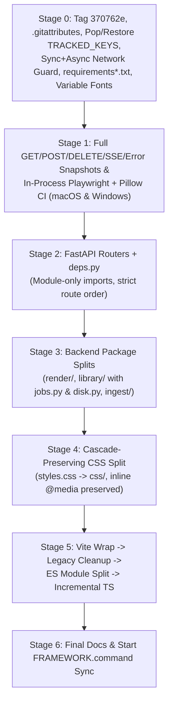

# Master Plan: Repository Structure Stabilization & Modernization

## Executive Summary

This master plan governs the stabilization and modular decomposition of the **FRAMEWORK** repository (`reader/`). It decomposes all monolithic backend and frontend files while enforcing strict pre-flight hermeticity, deterministic API/SSE snapshots, cross-platform Playwright visual gates in GitHub Actions, and clean per-stage rollback boundaries.

### Binding Architectural & Governance Decisions
1. **Per-Stage Branching & Tagging**: Execute each stage on its own branch + PR (`stage-0-...` through `stage-6-...`). Merge only after passing its full gate, and tag each passed gate (`stage-0-passed`, ..., `stage-6-passed`).
2. **GitHub Actions CI (macOS + Windows)**: Add `.github/workflows/ci.yml` running `pytest` with `REQUIRE_BROWSER=1` on both `macos-latest` and `windows-latest` (and generating/verifying `win32` visual baselines).
3. **Committed Fixed-Name `dist/` Bundle**: Vite emits **fixed, unminified** files (`app.js`, `app.css`, `index.html`, `build-stamp.json`) into `reader/static/dist/` committed to Git. Python-only users need zero Node.js at runtime. Pin Node (`reader/frontend/.nvmrc` + `engines`) and commit `package-lock.json` so Vite builds produce identical `dist/` diffs across machines.
4. **Frontend Dev Loop**: Run `vite build --watch` alongside `uvicorn app.main:app --reload --reload-dir app` (single origin, matches production).
5. **Plain ES Modules First -> Incremental TypeScript (Vanilla)**: Wrap untouched `app.js` in Vite first (keeping vendored `marked`/`DOMPurify` globals until the split), then extract ES modules with a single shared state object (`src/state.js`) and `src/nav_bridge.js`, and finally migrate `.js` -> `.ts` incrementally.
6. **Strict Visual Baselines**: Use `unittest.skipUnless` (never `pytest.importorskip`), pinned `playwright` + `Pillow` in `reader/requirements-dev.txt`, `device_scale_factor=1`, fixed `page.clock` + frozen server time, `REQUIRE_BROWSER=1` for gates, and fail on missing baselines unless `UPDATE_BASELINES=1` is passed.
7. **Stage 0 Local Variable Fonts**: Host variable Geist and Inter `.woff2` files + OFL licenses in `reader/static/fonts/` in Stage 0 with `@font-face` family names matching `--sans` (`"Geist"`, `"Inter Variable"`, `"Inter"`).
8. **Incremental `CLAUDE.md` Sync**: Update `CLAUDE.md` at the end of Stages 2–5, with a final sweep (including `Start FRAMEWORK.command`) in Stage 6.

---

## Architecture Roadmap



---

## Directory Hierarchy

```
docs/plans/repo_structure_stabilization/
├── MASTER_PLAN.md
├── stage-0_preflight_and_baseline/
│   └── README.md
├── stage-1_snapshots_and_browser_tests/
│   └── README.md
├── stage-2_backend_routers/
│   └── README.md
├── stage-3_backend_package_splits/
│   └── README.md
├── stage-4_css_modularization/
│   └── README.md
├── stage-5_frontend_es_modules_vite_ts/
│   └── README.md
└── stage-6_documentation_sync/
    └── README.md
```

---

## Stage Summaries & Hard Gates

### Stage 0: Pre-Flight & Clean Baseline
- **Baseline Tag**: Tag commit `370762e` as `pre-stabilization-baseline`.
- **Pop-and-Restore Env Hygiene**: In a shared test base class, save and **remove (`os.environ.pop(k, None)`)** all 6 `TRACKED_KEYS` (`DOL_API_KEY`, `ANTHROPIC_API_KEY`, `ANTHROPIC_MODEL`, `NEWS_AGENCIES`, `NEWS_SYNC`, `NEWS_RETENTION_DAYS`) and restore them in cleanup—**never** set them to `""` (because `NEWS_AGENCIES=""` breaks 4 tests in `config.py:72`).
- **Dual-Transport Network Guard**: Patch both `httpx.HTTPTransport.handle_request` and `httpx.AsyncHTTPTransport.handle_async_request` (covering `AsyncAnthropic` in `chat.py:84`) in a shared `unittest.TestCase` base class applied to **all** test suites (works under both `pytest` and `unittest discover`).
- **`.gitattributes` & Pinned Python Deps**: Add `.gitattributes` (`reader/frontend/** text eol=lf`, `*.png binary`, `*.woff2 binary`) so Windows CRLF checkouts never break `build-stamp.json`. Create `reader/requirements.txt` and `reader/requirements-dev.txt` (exact pins for `playwright`, `Pillow`, `pytest`), avoiding `pyproject.toml` in `reader/`.
- **Local Variable Fonts + OFL**: Ship variable `.woff2` files and OFL licenses in `reader/static/fonts/` with `@font-face` matching `"Geist"` and `"Inter Variable"` (`styles.css:10`), removing Google Fonts `<link>` tags (`index.html:9-11`).
- **Gate**: All tests pass under both `pytest` and `unittest discover` with populated `reader/.env`.

### Stage 1: API/SSE Snapshots, Playwright & CI Workflow
- **Deterministic API & SSE Snapshots (`test_api_snapshots.py`)**:
  - Patch `config.ROOT_DIR` (settings), stub `library.ecfr_titles`/`ecfr_title`, normalize volatile timestamps.
  - Snapshot all GET routes, all POST/DELETE routes (using a fresh unstarted `Queue` so background downloads never race, and stubbing `news_worker.request_sync` for `/api/news/refresh`), error shapes (`404`, `409`, `422`, `503`), and **`/api/chat` + `/api/{title}/chat` SSE streams** (`text | tool | tool_result | done | error`) using a fake `AsyncAnthropic`.
- **In-Process Playwright + Pillow Visual Baselines (`test_browser_parity.py`)**:
  - Launch `uvicorn` on `127.0.0.1:0` in a background thread. **Leave `NEWS_SYNC` enabled** and stub `news_worker.start` + `news_worker.request_sync` so the News page does not enter the 503 "sync is off" state.
  - Use `try/except ImportError` + `unittest.skipUnless` (never `pytest.importorskip`), `REQUIRE_BROWSER=1` to forbid skips in gates/CI, `device_scale_factor=1`, frozen `page.clock` + frozen server `now` (`news_schedule`/`news_store`), seeded `localStorage`, and `reduced_motion="reduce"`.
  - Fail on missing Pillow baselines (`tests/baselines/{darwin,win32}/`) unless `UPDATE_BASELINES=1` is set.
- **GitHub Actions CI**: Add `.github/workflows/ci.yml` running `pytest` with `REQUIRE_BROWSER=1` on `macos-latest` and `windows-latest`.
- **Gate**: All snapshots, Playwright parity tests, and CI pass on both OSes.

### Stage 2: FastAPI Route Decoupling (`reader/app/main.py`)
- Create `reader/app/routers/deps.py` for shared dependencies (`valid_installed_title`, `require_key`, `NO_STORE`, `STREAM_HEADERS`, Chat models).
- **Module-Only Import Rule**: Routers and `deps.py` MUST import modules (`from .. import config, library, store, chat`), NEVER individual functions (`from ..config import installed_titles`), so existing test patches on `config.installed_titles`, `library.queue`, `library.installed`, etc. stay effective.
- Extract `settings.py`, `library.py`, `news.py`, `reader.py`, and `chat.py` (preserving both global `/api/models`, `/api/chat` and title-scoped `/api/{title}/models`, `/api/{title}/chat`).
- Enforce global and internal route registration order + explicit route-precedence tests. Sync `CLAUDE.md`.
- **Gate**: All tests + Stage 1 snapshots + `REQUIRE_BROWSER=1` CI pass.

### Stage 3: Core Backend Package Splits (`render.py`, `library.py`, `build.py`)
- **`reader/app/render/`**: `text.py`, `hierarchy.py`, `linkifier.py` (preserving `_CROSS_TITLE`, `_NUM_IN_LIST`, `_XREF` for `news.py:23`), `units.py` (housing `section_doc` for `store.py:12` and `SectionDoc`), `html.py`, and `__init__.py`.
- **`reader/app/library/`**: `client.py`, `suites.py`, **`disk.py`** (not `storage.py`), **`jobs.py`** (not `queue.py`), `views.py`, and `__init__.py`. Every patchable function call—even intra-file calls like `Queue` calling `run_job`—must call through the package (`lib.run_job(...)`).
- **`reader/app/ingest/`**: `tree.py` (injecting `log=log` to avoid circular imports with `build.py`) and `parse.py`, keeping `python -m app.build` intact. Sync `CLAUDE.md`.
- **Gate**: All tests + Stage 1 snapshots + `python -m app.build --help` + CI pass.

### Stage 4: Cascade-Preserving CSS Split (`reader/static/styles.css`)
- Split `styles.css` into `reader/static/css/` in exact original cascade order (assigning `Home` at line 542 to `05_home_overview_lib.css` and keeping the 6 inline `@media` blocks at lines 756, 971, 1048, 1053, 1217, 1457 in their respective feature files).
- Update CSS slice assertions in tests and sync `CLAUDE.md`.
- **Gate**: All tests + `REQUIRE_BROWSER=1` Pillow screenshot baselines pass on macOS and Windows.

### Stage 5: Vite Wrap -> Legacy Cleanup -> ES Module Split -> Incremental TypeScript
1. **5A — Vite Baseline Wrap**: Initialize `reader/frontend/` with pinned Node (`.nvmrc` + `engines`) and committed `package-lock.json`. Configure fixed unminified outputs (`app.js`, `app.css`, `index.html`, `build-stamp.json` with LF-normalized sorted SHA-256 hash). Keep vendored `marked` (15.0.12) & `DOMPurify` (3.4.17) as classic scripts in `frontend/public/vendor/` during 5A so `app.js` stays 100% unchanged; keep `<head>` pre-paint script inline/blocking; switch `main.py:90` to `static/dist/index.html`. Add `test_build_stamp.py` (LF-normalized).
2. **5B — Remove Legacy Files & Repoint Tests**: Delete `static/app.js`, `static/styles.css`, `static/index.html`, `static/vendor/`. Repoint HTML checks to `frontend/index.html`; retire brittle JS function-slicing checks in favor of Stage 1 Playwright tests (`REQUIRE_BROWSER=1`).
3. **5C — Plain ES Module Split**: Move 43 top-level `let`/`var` into `src/state.js` (`export const state = { ... }`), break circular calls via `src/nav_bridge.js`, migrate `marked` (15.0.12) and `dompurify` (3.4.17) to pinned npm imports, add a multi-file source-concatenation helper for remaining JS contract tests (`NAV_TARGETS`, `GO_KEYS`, `/^Digit[1-7]$/`), and update `test_news_frontend.py`'s `NEWS_CITE_RE` path to the extracted module.
4. **5D — Incremental TypeScript Migration**: Add `tsconfig.json` (`allowJs`, `checkJs`), expand `src/api/` and `src/types/`, migrate `.js` -> `.ts` module-by-module keeping `NEWS_CITE_RE` extraction safe. Sync `CLAUDE.md`.
- **Gate**: `test_build_stamp.py` + `REQUIRE_BROWSER=1` Playwright + Pillow baselines pass on macOS & Windows.

### Stage 6: Final Documentation & Launcher Sync
- Update `Start FRAMEWORK.command` (line 26) to `pip install -r "$ROOT/reader/requirements.txt"` (fixing missing `tzdata`).
- Final consistency sweep across `CLAUDE.md`, `README.md`, `reader/README.md`, and `reader/API.md`.
