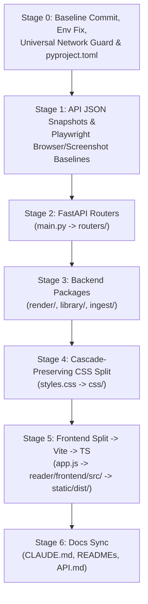

# Master Plan: Repository Structure Stabilization & Modernization

## Executive Summary

This master plan governs the stabilization and modular decomposition of the **FRAMEWORK** repository (`reader/`). It resolves the architectural risks of monolithic files (`reader/static/app.js` at 5,950 lines, `reader/static/styles.css` at 2,066 lines, `reader/app/render.py` at 833 lines, `reader/app/library.py` at 647 lines, `reader/app/build.py` at 593 lines, and `reader/app/main.py` at 453 lines) while enforcing strict **pre-flight safety gates** and **zero-regression verification**.

### Binding Architectural Decisions
1. **Frontend Distribution (`dist/` in Git)**: Built assets emit to `reader/static/dist/` and are **committed to Git**. Python-only setups (including Windows) continue to run via `pip install` + `uvicorn` with **zero Node.js runtime dependency**.
2. **Frontend Refactor Path (Vanilla JS Split -> Incremental TypeScript)**:
   - First, split `reader/static/app.js` into **plain ES modules** under `reader/frontend/src/` using a **shared mutable state object** (`state.js`) and an event/callback dispatcher (no UI framework such as React/Preact/Lit, and preserving intentional in-place DOM updates like the transfer dock and `refreshSettingsViews`).
   - Second, enable `allowJs`/`checkJs` and migrate modules to **TypeScript** (`.ts`) module-by-module.
3. **Browser Verification Gate**: Add **Playwright** via `pip` inside `reader/tests/` (skipping gracefully when Playwright/browser binaries are absent) to lock behavioral and visual parity *before* touching `styles.css` or `app.js`.
4. **Execution Sequence (Safe Order)**:
   - **Stage 0**: Clean baseline commit, fix `DOL_API_KEY` test leak, enforce universal network guard, pin Python deps.
   - **Stage 1**: Record API JSON response snapshots & establish Playwright browser parity + screenshot baselines.
   - **Stage 2**: Backend FastAPI router extraction (`main.py` -> `routers/`).
   - **Stage 3**: Backend core engine & ingestion package splits (`render/`, `library/`, `ingest/`).
   - **Stage 4**: CSS modularization (`styles.css` -> `css/`), verified against Stage 1 screenshot baselines.
   - **Stage 5**: Frontend ES module split -> Vite build (`static/dist/`) + local fonts -> incremental TypeScript.
   - **Stage 6**: Documentation sync (`CLAUDE.md`, `README.md`, `reader/README.md`, `reader/API.md`).

---

## Architecture Blueprint



---

## Directory Hierarchy

```
docs/plans/repo_structure_stabilization/
├── MASTER_PLAN.md
├── stage-0_preflight_and_baseline/
│   └── README.md
├── stage-1_snapshots_and_browser_tests/
│   └── README.md
├── stage-2_backend_routers/
│   └── README.md
├── stage-3_backend_package_splits/
│   └── README.md
├── stage-4_css_modularization/
│   └── README.md
├── stage-5_frontend_es_modules_vite_ts/
│   └── README.md
└── stage-6_documentation_sync/
    └── README.md
```

---

## Stage Summaries & Hard Gates

### Stage 0: Pre-Flight & Clean Baseline
- **Baseline Commit & Tag**: Commit existing uncommitted work (`CLAUDE.md`, `app.js`, `index.html`, `styles.css`, `test_settings_env.py`) and tag a baseline commit so "parity" has a fixed reference.
- **Fix `DOL_API_KEY` Test Leak**: Clear `DOL_API_KEY` in `NetworkGuardTestCase.setUp` (in `reader/tests/news_fixtures.py`) so tests pass reliably even when `reader/.env` contains a real key (currently 9 tests fail in `test_news_api.py` and `test_news_fetch.py`).
- **Universal Network Guard**: Apply `httpx.HTTPTransport.handle_request` blocking across *all* test suites (including `test_library.py` and `test_api_endpoints.py`), not only news suites.
- **Pin Python Dependencies**: Add `reader/pyproject.toml` (or `reader/requirements.txt`) matching the documented install command (`fastapi`, `uvicorn[standard]`, `httpx`, `anthropic`, `python-dotenv`, `pytest`, `tzdata`, plus optional `[dev]` group for `playwright`).
- **Gate**: `PYTHONPATH=reader pytest reader/tests` passes **221/221** with `reader/.env` populated.

### Stage 1: API Snapshots & Browser Parity Harness
- **API JSON Snapshots**: Because FastAPI routes declare no `response_model`, OpenAPI schemas lack response shapes. Record JSON snapshots for every endpoint against `FakeTitles` before touching backend routes.
- **Playwright Browser Tests (`pip`)**: Add automated browser tests against the untouched `app.js` + `styles.css` covering:
  - Hash routing (`#/`, `#/library`, `#/news`, `#/projects`, `#/settings`, `#/help`, `#/title/{t}/section/{s}`)
  - Rail & sliding drawer states (`drawer-collapsed`, `drawer-retracted`, `drawer-fly`, width resize)
  - Keyboard shortcuts (`⌘B`/`Ctrl+B`, `G` then `O/H/C/P/N/L/S`, `Alt+1..7`, `>` command palette)
  - Transfer dock in-place updates, live search dropdown, `.env` modal, and section pin popover
  - Visual screenshot baselines across dark/light themes and desktop/mobile (`<=900px`) viewports
- **Gate**: Snapshots committed/verified; Playwright suite passes against baseline UI (skips cleanly if Playwright is not installed).

### Stage 2: FastAPI Route Decoupling (`reader/app/main.py`)
- Extract `reader/app/routers/`:
  - `settings.py` (`/api/settings/env`)
  - `library.py` (`/api/library/*`) — **critical internal ordering**: fixed paths (`/jobs`, `/jobs/clear`, `/storage`, `/storage/prune`, `/wire`, `/batch-download`, `/update-all`, `/download`) MUST precede `/{title}`.
  - `news.py` (relocated from `news_api.py`)
  - `reader.py` (global aliases `/api/meta`, `/api/tree`, `/api/section/...`, `/api/part/...`, `/api/search`, `/api/titles`, and `title_router` at `/api/{title}/...`)
  - `chat.py` (global `/api/models`, `/api/chat`; **note**: title-scoped `/api/{title}/models` and `/api/{title}/chat` stay registered on `title_router` or mount under `prefix="/api/{title}"`)
- **Critical Registration Order**: All fixed-prefix routers (`/api/settings`, `/api/library`, `/api/news`) MUST mount **before** `title_router` (`prefix="/api/{title}"`), otherwise FastAPI returns 422 errors. Add explicit route-precedence tests for every fixed prefix.
- **Gate**: 221+ pytest tests pass + 100% match against Stage 1 API JSON snapshots.

### Stage 3: Core Backend Package Splits (`render.py`, `library.py`, `build.py`)
- **`reader/app/render/`**: Split into `text.py`, `hierarchy.py`, `linkifier.py`, `units.py`, `html.py`, and `__init__.py` facade. Expose clean citation regex constants (preserving `_CROSS_TITLE`, `_NUM_IN_LIST`, `_XREF` aliases so `news.py:23` stays intact).
- **`reader/app/library/`**: Split into `client.py`, `suites.py`, `storage.py`, `queue.py`, `views.py`, and `__init__.py`.
  - **Test Stub Preservation Rule**: Tests patch 34 functions directly on `library` and `build` (e.g. `library.ecfr_titles`, `library.installed`, `build.fetch_json`, `build.download_stream`). Submodules MUST call sibling functions via the package/module namespace (e.g., `import app.library as library_pkg; library_pkg.ecfr_titles()`) rather than direct `from .client import ...` bindings that silently bypass `unittest.mock.patch`!
- **`reader/app/ingest/` (from `build.py`)**: Extract `tree.py` (nesting/trimming) and `parse.py` (`stream_parse_xml`), keeping `python -m app.build` working as the CLI entrypoint and preserving module-level patch targets.
- **Gate**: Full pytest suite + API JSON snapshot parity + `python -m app.build` CLI smoke check.

### Stage 4: Cascade-Preserving CSS Split (`reader/static/styles.css`)
- Split `styles.css` into `reader/static/css/` in **exact original cascade order** (`tokens.css` -> `base.css` -> `layout.css` -> `components/...` -> `views/...` -> `responsive.css`).
- Update CSS string-slicing assertions in `test_news_frontend.py`, `test_settings_env.py`, and `test_sidebar_rail.py` to target the respective modular CSS files (or rely on Stage 1 Playwright style/screenshot tests).
- **Gate**: Stage 1 Playwright screenshot baselines pass with zero visual regressions.

### Stage 5: Frontend Plain ES Modules -> Vite -> Incremental TypeScript
1. **Plain ES Module Split (`reader/frontend/src/`)**:
   - Move the **43 top-level `let`/`var` variables** (`routeSeq`, `railObserver`, `currentTitle`, `treeData`, `isGenerating`, etc.) into a single shared mutable state object (`src/state.js`) so imported modules never hit ES module read-only binding errors (`routeSeq++`).
   - Break hoisted circular calls (`syncNavToRoute` ↔ views) via an explicit lightweight dispatcher (`src/nav_bridge.js`), avoiding a reactive framework rewrite and keeping deliberate manual DOM patching (transfer dock numbers, `refreshSettingsViews`) intact.
2. **`index.html`, Local Fonts & Vendor Assets**:
   - Keep the `<head>` pre-paint theme and `railState` script **inline and blocking**.
   - Localize **Geist and Inter fonts** under `reader/frontend/public/fonts/` instead of Google Fonts (`index.html:9-11`), making the app truly local-first.
   - Bundle pinned `marked` and `dompurify` via npm in Vite (retiring manual vendor copies or keeping them in `public/`).
   - Configure Vite with `base: '/static/dist/'`, emitting production builds into `reader/static/dist/` (committed to Git). Update `reader/app/main.py` (`/` route) to serve `config.STATIC_DIR / "dist" / "index.html"`.
   - Document `uvicorn app.main:app --reload --reload-dir app` so `reader/frontend/node_modules` never triggers reloader stalls.
3. **Frontend Test Migration**:
   - Retire brittle source-text slicing tests (`function renderHelp(`, `split("function renderSettingsPanel(")`) in favor of Stage 1 Playwright behavioral tests; keep `NEWS_CITE_RE` Python-JS parity test reading directly from `reader/frontend/src/views/news.js` (or `citations.js`).
4. **Incremental TypeScript Migration**:
   - Enable `allowJs: true`, `checkJs: true` in `tsconfig.json`, and convert modules from `.js` to `.ts` one by one without breaking regex/source contracts.
- **Gate**: Vite builds cleanly; committed `reader/static/dist/` passes all Playwright behavioral + screenshot parity tests; all Python tests pass without Node installed when running from `dist/`.

### Stage 6: Documentation Sync
- Update `CLAUDE.md` (which currently documents ~100 `app.js` symbol names, `--reload`, and lack of `pyproject.toml`), `README.md`, `reader/README.md`, and `reader/API.md` to reflect the modular backend, `reader/frontend/`, committed `reader/static/dist/`, `uvicorn --reload --reload-dir app`, and Playwright test instructions.
